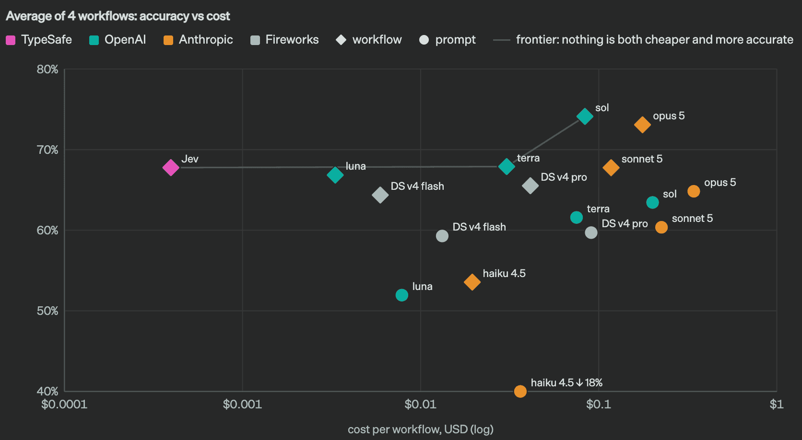

# Chapter 1 A Model That Only Answers Multiple Choice

## 1. Why does Jev, a model that generates no text, dare to call itself frontier intelligence?

Jev belongs to the new category of System One models, built for fast, structured decisions that software can consume directly: it reads in a state and returns a typed answer with a probability. It understands natural language input the way language models do, but returns decisions instead of generating text; on System One tasks it reaches intelligence comparable to existing large language models while being two orders of magnitude faster and two orders of magnitude more efficient. The price is giving up string generation, exchanged for optimized structured output and no hallucination.

The interface promise is just as explicit: possible outputs and structures are defined in advance, the model never makes a type error, and every answer comes with a calibrated probability and a confidence score. Input is $0.042 per million tokens, output is free; end-to-end response runs 70 to 500 milliseconds, and for System One-shaped queries it is 40 to 200 times faster at an equivalent level of frontier intelligence (snapshot as of 2026-09-28; may change during early access).

The nerve behind the frontier claim, and its limit, sit in the last clause: calibration is measured across a set of predictions and guarantees nothing about any single answer being correct; the purpose of confidence is to decide when to execute and when to escalate to a human or a reasoning model. The word frontier is scoped to the System One task domain; generation and reasoning beyond that domain are not on this table of promises.

Three mechanical details ground the speed and the cheapness. Sampling is parallel: a parallel sampler generates all outputs at once within a single query, skipping the token-by-token autoregressive decoding of large language models in which each token is conditioned on the previous one, and the implementation is highly hardware-aware. Outputs are structured values from a closed set: possible outputs and structures are defined in advance, the model returns only typed decisions that fall inside the set, and free text is not part of the output set. Taken together, the three make the position clear: it sits between the traditional LLM and the classical classifier.

| Dimension | Traditional LLM | Jev | Classical classifier |
| --- | --- | --- | --- |
| Output | Free text | Typed decisions | Labels or scores |
| Latency | Seconds | 70 to 500 milliseconds | Sub-millisecond |
| Input price | $0.20 to $10 per million | $0.042 per million | No cost when local |
| Output billing | Roughly 5x the input price | Free | None |
| Structural determinism | Wording can vary every time | Fixed, with confidence | Fixed |
| Training method | Pretraining plus preference alignment | RLCD calibration training | Supervised training on labeled data |
| Best for | Generation, reasoning, planning | Classification, routing, scoring, gating | In-domain classification |

## 2. Is the System One name borrowed fittingly or appropriated wrongly?

The name comes from Kahneman's Thinking, Fast and Slow: System One is fast and intuitive, System Two is slower and more deliberate, and the category name takes this pair of distinctions. Large language models that reason via chain of thought are System Two; System One models are the fast half, existing independently, centered on fast, focused judgment. The error-proneness implied by System One thinking is acknowledged as well; the claimed direction is that System One models can be made more reliable than the alternatives, with the argument left for later.

The misappropriation reading has textual grounds: humans generate language subconsciously with System One, so by that standard every large model to date has been doing System One thinking; System Two thinking requires consciousness, which AI lacks, so even reasoning models remain System One. A chess interface that uses Jev as the black pieces turns this judgment into something you can watch: all server-validated legal candidate moves are fed into the model, which picks one in about 300 milliseconds and about $0.00004 per move. Live feedback was that it plays badly and gives away a piece every move; the qualitative read was that it is essentially playing bullet chess, with no time to reason, moving on knee-jerk reflex alone.

The harder point is not about naming: more layers of indirection appear on the documentation's avoidance list, and the model struggles on tasks that need additional levels of indirection. Set aside whether the name is precisely apt; it matches the model's real capability boundary: the fast, intuitive half that does no multi-hop reasoning.

| Dimension | System One (Jev) | System Two (LLM) |
| --- | --- | --- |
| Output | Typed decisions | Free text |
| Latency | On the order of 0.1 seconds | Seconds to tens of seconds |
| Cost | On the order of $0.000081 per call | On the order of $0.0138 per call |
| Determinism | Fixed structure, with confidence | Wording may differ each time |
| Strengths | Classification, routing, scoring, gating | Open-ended reasoning, writing, planning |

## 3. The official claim is zero hallucination, so why is the community up in arms?

The claim stops at the mathematical level: the model is optimized for structured output and produces no hallucination; possible outputs and structures are defined in advance, and the model never makes a type error. A falsification path comes with it: a single counterexample would be enough to overturn the claim, but that is mathematically impossible; the 0% in the hallucination-rate chart comes from guaranteed schema matching, not from a measured number. The interface-level argument is set closure: outputs always land inside the set the predefined schema allows, so a type error is mathematically impossible. The comparative argument is a two-bar chart: structured-output error rate 0% for Jev against 45.5% for Claude Haiku 4.5, tool-call error rate 0% against 17.0% for GPT-6 Sol; Jev's 0% remains a guaranteed figure, while the LLM side comes from OpenRouter measurements, where complex queries may even be routed to stronger models.

The fight is over another layer of semantics: saying it cannot hallucinate sounds crazy, because it will still route a billing question to the development department and still answer an obvious yes/no question wrong; it cannot emit an invalid type, yet a legal value that is completely wrong goes out all the same. The schema guarantee blocks format errors and is powerless against picking the wrong option, so the result is an error that is flawless in format; type safety is not factual correctness, and approving an unauthorized action still satisfies the schema guarantee.

The response is a counter-question: does a linear classifier hallucinate? A random forest does not hallucinate the way a large language model does, yet the system still returns wrong answers rather than refusing to answer. Calibration is measured across groups and guarantees nothing about any single answer; the purpose of confidence is to decide when to execute and when to escalate to a human or a reasoning model. The price is that no explanation is available when the answer is wrong: a model that cannot write a paragraph cannot write a paragraph about why it was wrong.

## 4. Is the shut-up model nickname, applied at launch, an injustice?

The phrase "the shut-up model" first appeared in the title of a V2EX post: "I Packaged the Viral Hit Jev (TypeSafe AI's 'Shut-Up Model') into a Registration-Free One-Click Bundle". The poster has no connection to TypeSafe; what they did was package an open-source replica model from HuggingFace into a Windows one-click bundle. The post's description of the model: it generates no text at all; ask it any question and it outputs only options and probabilities.

Hype and the barrier to entry are put on the table together: for work like routing, filtering, scoring, and yes/no checks it is 20 to 200 times faster than an LLM and 40 to 400 times cheaper, with a single judgment taking about 380 milliseconds; the open-source replica drew 3,000 stars in two days, but the real product requires an application and approval or Vercel access, pay-as-you-go billing, and hand-written code to call the API. The one-click bundle is 1.66GB, works right after unzipping, runs on a CPU, ships with a bundled Python environment, and needs no registration, no invite code, no activation code.

Whether it is an injustice depends on what you ask. The narrowest judgment primitive is called Noul: it evaluates a yes/no question and returns the probability that the answer is yes; 0 means no, 1 means yes, and intermediate values mean the model sees yes and no as close possibilities. The distribution over the two outcomes is fully described by this one number. Thresholds live in code: use 0.5 when yes and no are equally fine to act on, raise it when a false yes is costly, lower it when missing a true yes is costly.

The boundary of use is written plainly: it suits routing, filtering, and scoring; it does not suit judgments that need a reason explained, and expecting it to write articles is a mistake. Called the shut-up model, it is not wronged: text generation is not part of the product definition, and the nickname sticks precisely to the one thing it does not do.

## 5. Does the undergrad-homework mockery hold up?

The mockery came from a replication test. Deploy Qwen3.8 27B with vllm, craft a prompt, read top-k logprobs straight from the API, and take the probabilities of each option's tokens through a softmax or proportional weighting to convert them into option probabilities; no custom sampling is needed, just a few lines of script. End-to-end latency came in under 100 milliseconds including network latency, no slower than the official API, which in practice mostly runs above 1,000 milliseconds; agreement across a range of simple and hard cases was 100%. The conclusion in one sentence: basically garbage at the level of an undergraduate machine learning homework assignment.

The rebuttal couplets are just as direct: even if the performance is close, what about the inference cost of a commercially deployed 27B? How is stable JSON output solved? If stable, cheap, and fast are all homework-level, why was it not built sooner? The original poster replied: reading only the first token's logprobs does not involve stable JSON output, and constrained decoding stopped being hard long ago. The third counter took up the cost question: 0.6 to 2B small models are table stakes, so deployment cost is hardly the issue; even with a general model, have it output only the answer, search the output for the answer word, and assemble the JSON yourself, and 99% of the noise drops out; on the rare 1% that cannot be recognized, run it again, since it runs fast anyway.

A pre-registered experiment moved the fight into a reproducible frame. On a frozen Qwen3-4B, turning every closed-option field in the schema into a lettered multiple-choice question and reading the option letter's score at the answer slot matched accuracy with token-by-token JSON generation under grammar constraints (0.907 vs 0.909); letting the model write out probabilities itself collapsed to 0.346, with 62% of its "choices" landing on the first option. Practitioners who have done similar zero-shot classification fill in the other side: they tried the same thing with a 4B Qwen; the speed and cheapness were similar, but it could not reach the intelligence level this model displays.

## 6. What does the manifesto tweet, bookmarked by nearly 60,000 people, promise when pushed to its conclusion?

The manifesto tweet opens with a question asked after co-inventing ChatGPT: why did superhuman chat models not bring AGI? Over the past two years a new model training method, RLCD, and a new type of frontier model were built in secret, and Jev was released: frontier composable intelligence optimized for decisions, 20 to 200 times faster and 40 to 400 times cheaper, with output tokens free; self-described as the shortest path to an AI-based economic revolution. The numbers: 39.75 million views, 58,851 bookmarks.

The same tweet appended the price terms: the gains are not free; Jev cannot generate text. Pricing is $42 per billion input tokens, output free forever, made too cheap to meter by the new architecture. The name comes from William Stanley Jevons: improving steam engine efficiency raised coal demand instead of lowering it, and machine intelligence is expected to walk the same road, with every order-of-magnitude drop in the cost of intelligence unlocking an order of magnitude more use cases. The Doom demo's numbers are equally aggressive: about 10 calls per second, about $7 per hour.

The homepage's 193.6x faster and 444.6x cheaper come from four in-house-built workflow benchmarks, and the expectation belongs to the high end of real-world gains. The substance of the promise is three things: decisions become intelligent, costs drop until judging everything is viable, and it composes into ordinary code; the one thing not promised is generating text.

## 7. Before building, how do you judge whether your pipeline needs Jev?

The screening rule before building is that all three conditions must pass. The pipeline contains high-frequency, structured decisions currently carried by regexes that embarrass you or LLM calls that cost too much; the latency and cost numbers must hold on your own data, not on TypeSafe's benchmarks; and you can accept wrong answers that arrive with a probability and no explanation, tolerate them, or route low-confidence cases elsewhere.

The most common disqualification is the first condition, the gate most teams fail: many pipelines have exactly one LLM call doing work that genuinely needs text, so there is nothing to move; the pattern pays off where an LLM is being used as a very expensive classifier, or where a classifier was set up because the LLM was too slow. The second condition is cheap to test: run your own states through both your current model and Jev and see whether the gap looks more like 40x or 4x; the headline numbers sit toward the high end of the realistic range, so expectations should be set below them, and testing on your own data is exactly what that sentence prescribes.

The third condition is a design decision, not a benchmark: calibrated probabilities let you set a threshold and send everything below it to a human or a slower model. If every decision must be explainable after the fact, a model that produces no reasoning is the wrong tool no matter how fast it is; that is not a criticism of the category, it is the category's boundary.

## 8. Which judgments go to Jev and which must stay with the large model?

The division of labor runs between text and judgment, between the two verbs generate and decide: work that needs content generated belongs to the large model; focused decisions with defined answers and native probabilities belong to Jev. Large language models keep the work that needs text or long reasoning: writing, explaining, planning, conversation; the System One model takes over small, structured, frequent decisions: which queue to enter, whether an alert is worth a human's attention, whether a row matches a filter condition, whether an agent run counts as acceptably complete. On a pipeline this comes down to one call per row, per event, and per tool call; agents do open-ended work, and the decision model sits at each checkpoint, asking typed questions of the state.

Use Choice for form routing, tool-call review, response model selection, and document classification; Score for ticket priority; Noul for content moderation flags; Noul or Score for answer evaluation. Decisions that require interpretation go to Jev; fixed business rules stay in code.

The boundary is just as clear in the model comparison: GPT-6 Astra's structured output can also constrain classification to a set of labels, but the schema constrains format, and a legal class can still be the wrong dispatch; Jev's Choice comes with a probability distribution over every option, and the program uses the distribution to decide accept or escalate. Jev handles focused decisions with defined answers; Astra handles tasks that still need content generation or tools to address broader questions. On the same ticket, queue selection goes to Jev; investigating why it failed and drafting the reply stay with Astra.

| Use case | Question type | Description |
| --- | --- | --- |
| Form routing | Choice | Submitted fields and destination criteria go into the state; select the owner or request re-review |
| Ticket priority | Score | Customer report and relevant service context go into the state; return a recommended priority |
| Tool-call review | Choice | Proposed tool name and arguments go into the state; allow execution or pause for approval |
| Response model selection | Choice | Request context and model descriptions go into the state; call the selected model |
| Document classification | Choice | Document text and category definitions go into the state; attach a category to the document record |
| Moderation flag | Noul | Content, context, and policy criteria go into the state; add a flag for the reviewer |
| Answer evaluation | Noul or Score | User request, generated answer, and reference material go into the state; record the evaluation result or request a revision |

## 9. How much can swapping out classification calls save in a year?

Jev bills only on the input side: $0.042 per million input tokens, output tokens entirely free (as of September 2026). Traditional LLM input prices run about $0.20 to $10 per million, and output is usually 5 times the input price. Cost grows only with input volume; the size of the state and the number of questions are the whole bill, and answer length adds nothing. After listing on OpenRouter on September 18, processing volume passed 161 billion tokens within days.

The paper benchmark for a single decision is just as explicit: $0.000081 and 0.114 seconds versus $0.013880 and 8.566 seconds, which is 444.6x cheaper and 193.6x faster; the input unit price is $42 per billion, 1/238 of Claude Fable 5.1's input price. Scaled to a task: 1 million text classifications at 2,000 tokens each, 2 billion input tokens in total, costs $84 on Jev; the same input through a general LLM at $5 per million costs $10,000 on input alone, with output extra. One cent covers about 240 single-question decisions. For pipelines that must judge every email, every ticket, every tool call, only this cost structure makes judging everything economically viable; before, such cases could only be handled with keyword rules or sampling.

Field measurements confirm the same order of magnitude. An internal-link audit of a 586-page website read every page and rebuilt the internal link graph in 45.1 seconds, placed 584 links, and rejected links on 139 pages for lack of suitable content, at a total cost of $0.21. On the same pages in the same time, Claude Opus 5 processed 21 pages and spent $1.43; per page that is roughly 190x more expensive, with a full run projected at $43; in the comparison, Opus stopped billing when Jev finished. The substance of the work was 8,790 yes/no judgments: whether a page has a genuine reason to link to another page, and whether anchor text already exists in the copy; at frontier prices this had always been paid page by page.

The 193.6x and 444.6x figures come from four in-house-built workflow benchmarks whose reference answers were taken from OpenAI and Anthropic outputs; the test contexts were deliberately designed to be short and high-density, favoring Jev, and the comparison LLMs were called through a System One wrapper that made them slower and more expensive than direct calls, so the figures sit at the high end of the realistic range. At equal intelligence the ordinary range is 40 to 200x faster, and the integration-side citation is up to 200x speed and 400x cheaper. Two third-party results point the same way: instruction safety classification came out 5 to 18x faster with higher accuracy; business email classification came out 10 to 20x cheaper, though the comparison model held a slight edge in decision accuracy. No public report of independent calibration verification exists yet.

Pricing sustainability is the last variable. Nothing yet proves the price excludes early subsidies; long-run durability needs time to test, and the expected trend is down, never up. These paper numbers work as hypotheses for a pilot, not as verbatim inputs to procurement ROI calculations.

## 10. Which self-acknowledged weaknesses should you understand before picking up Jev?

jev-1.13 cannot count reliably: characters in a word, occurrences of a word in a paragraph, entries in a long list, with error growing with the scale of what is counted. Settle the question first: why would counting need a model at all? For units a regex or parser can locate, counting belongs in code. Dates are read as text rather than time quantities; ordering, intervals, and window membership are all unreliable, and mixed formats, relative time, and domain boundaries like quarters and settlement windows are worse. The alternative is to split the work: extraction goes to the model, arithmetic stays in code.

Double negatives and complex indirection reduce reliability; questions nested inside questions and phrasings that need multi-hop reasoning spend accuracy, and the relevant parts should be called out by name. Accuracy drops when the state is stuffed with irrelevant details, because irrelevant content interferes; an oversized state also invites context corrosion. Retrieve and filter first, sending only the fields the question needs.

English is the primary training language. Other languages, Chinese included, are accepted but performance varies; test on your own content before entrusting non-English workloads. In one Norwegian field test of 24 documents, the model read municipal records and extracted PDFs, and even found the demand for a 70% share at the end of a twelve-page document; the gap is one of degree, not a switch. The conversion takes a further discount: the tokenizer averages about 2.06 characters per token on Norwegian, so the 32K state ceiling fits only about 64,000 characters, not the 120,000 you might guess from English. In that test the longest document, 53,000 characters, did fit; measure your own documents before planning. The model is not trained to generate text, and forcing chained generation is slow and poor. When the answer space is bounded, list candidates first with a regex or a generative model, then have it pick the correct extraction; if you genuinely need text generation, other models exist.

Longer instructions push probabilities toward the middle. On the same set of questions, the expected calibration error of draft wording was 0.040; cautious wording with qualifiers raised it to 0.116, and judgments landing in the 0.3 to 0.7 range rose from 24 to 41. Write Jev questions the way you would ask a colleague across the table; keep the fine print in your own code.

## 11. Is it old wine in a new bottle next to traditional ML classifiers?

The list of old-wine identifications is not short. GLiNER2 was identified as "basically what they already have"; a finer comparison: encoder-based, generates no text, multi-task in a single forward pass, deterministic outputs, constrained classification, like GLiNER2 or a modified 2.5. Zero-shot classification with things like Facebook BART has existed for years. People who could not wait out the waitlist were pointed straight at the deberta-v3-large zero-shot model: what sits under the hood is similar. Chinese-language discussions asked the same question: what is it better at than an LLM with constrained decoding?

The increment identifications are present too: encoder models already skip text generation and emit numeric outputs, with no hallucination and faster inference coming free; the hard part was always that you cannot train the model head without ML expertise, and you still have to amass large amounts of data. The increments identified this time are runtime-specified output shape (cardinality up to 255) and calibration. The verdict "this is just a zero-shot classifier" was met with "exactly correct", plus three qualifiers: a general model, with no training at all, focused on System 1 tasks.

Field tests in the ecosystem pin the difference down further. The open-source decision model Von 1.1 shared the flaw of most option-packing models: in JevBench's option-order diagnostic, one set of hard-tier options shuffled into four orders flipped 49.5% of answers, against 0 to 5% for the reference models; version 1.2 fixed it at the architectural level, with each option attending only to the premise and itself, and flips dropped to 0.0%. Old wine or not therefore splits into two layers: the interface is old; shipping output shape and probability calibration as a training-free product is new. The three decision primitives, choice for discrete answers, score for continuous values, noul for yes/no, are themselves the subject of this debate.

## 12. Why is RLHF called the root cause of automation's long-delayed arrival?

The causal chain starts with the training objective: RLHF teaches models to say what people prefer. That objective works for chatbots, but it equally rewards sycophancy and confident-sounding hallucination; preference optimization also causes mode dropping, where the model learns to favor a certain style and suppress other possible outputs. An output can be persuasive to humans yet fall short of the reliability unattended automation requires; human preference and machine trustworthiness are different optimization targets.

The status quo matches this chain: because software cannot make decisions itself, a human must stay in the loop correcting course; the rule enterprises set for customer-service bots is that they may only point users to documentation and may never make a real decision; software companies dare not take responsibility for outcomes, so they hand users a pile of suggestions and let them choose, which is why they cannot charge by the result. Even now that agents can run long-horizon tasks, a human still has to direct them, and every act of direction is a decision. The greatest value usually comes from the decision, not from execution or efficiency gains.

The reason AI cannot do without humans is found in the training process: the human was placed inside during training. RLHF is essentially collecting human preferences and optimizing for them, and nearly every large model today is trained this way. The endpoint of the loop is human satisfaction, and human satisfaction requires a human present. The lesson enterprises learned with real money: keep AI away from decisions that put the business at risk. The common practice is to pass the cost to users: show them all the information and let them decide.

## 13. On which objective does RLCD actually differ from RLHF and RLVR?

The three post-training routes each have their own north-star metric. RLHF optimizes human preference, turning pretrained models into chatbots trained to produce replies people prefer; InstructGPT and ChatGPT were both trained this way, and the co-inventor is TypeSafe's co-founder. RLVR optimizes pure right-or-wrong correctness, using verifiable rewards to build reasoning models that are strong on tasks like math but slower and more expensive. RLCD optimizes calibrated decisions, training the model to return decisions with calibrated probabilities instead of generating text. A result labeled 0.2 should occur about 20% of the time, one labeled 0.8 about 80%, one labeled 1.0 100%; these ratios describe a set of predictions and guarantee nothing about any individual answer.

The difference is whether the probabilities deserve trust. Modern LLM probability values do not truly represent confidence, especially after RLHF and RLVR; RLVR weights the tokens along the entire chain of thought leading to a correct answer, regardless of whether each token is itself right. It trains the model to produce correct answers, not to output an 80% likelihood.

RLCD makes calibrated probability the explicit optimization target: when the answer is "no", the distribution "yes 0.9, no 0.1" is penalized heavily and "yes 0.6, no 0.4" lightly. The existing academic counterpart is called calibrated reinforcement learning; the implementation details are unpublished, but the direction of the objective function is fixed: when the model does not know, it scores low.

## 14. What is the play behind squeezing frontier intelligence into a single function call?

The play fits in one sentence: think of Jev as a function call into frontier intelligence, unstructured state in, typed probabilistic decisions out. Behind it stands an entire new stack rebuilt for automation: a new model architecture, a parallel sampler built for maximum efficiency, and a training method called RLCD. The sampling difference is the core: large language models generate token by token, each token conditioned on the previous one, while Jev generates all outputs in parallel in a single query, highly hardware-aware; the pricing, with output too cheap to meter, is a direct projection of this path.

A comparison implementation in the ecosystem validates the same route. The contrastive language model CLM trains a state encoder and an action encoder with a contrastive objective: each state is pulled toward its true action and pushed away from every other action, and the two encoders serve directly as zero-shot action classifiers. CLM-8B performs on par with Jev on computer-use, gaming, and tool-call tasks, with inference up to 9x faster, and the speedup is most pronounced when candidate sets are large or actions can be reused across states.

Cache design is the watershed: Jev supports only state caching, while CLM's dual-encoder architecture lets state and action embeddings be cached and reused independently, sharply cutting latency in settings where the state keeps evolving but the action set stays fixed, which is the typical shape of tool calling, computer use, and gaming. The boundary is drawn by the comparison data too: Jev cannot serve as a verifier for long-horizon tasks, performing below a random-choice baseline, while lightly fine-tuned CLM reached 81.6% on DeepSWE and 87.6% on Terminal-Bench 2.1. Function-call intelligence is therefore not a universal answer; its place is at checkpoints with short states, fixed action sets, and high-frequency decisions.

