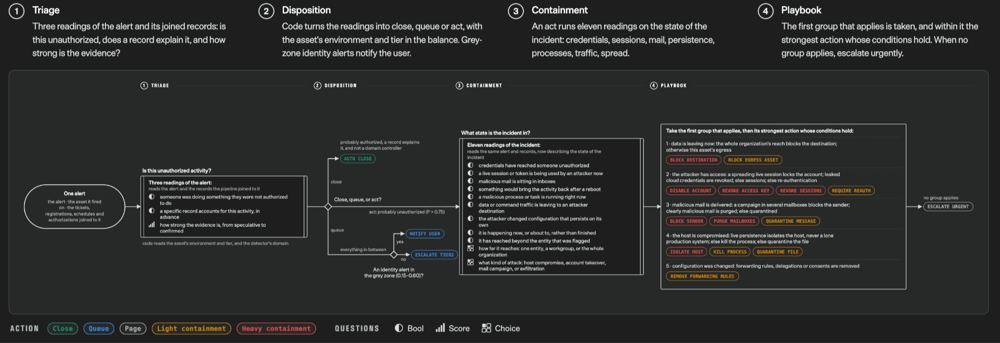

# Chapter 3 Breaking Judgments into Atomic Questions

## 29. How do you choose among Jev's three primitives: Choice, Score, and Noul?

The three primitives each answer one shape of question: Choice answers "which one of these options is it", returning the selected item, a probability for each option, and a confidence; Score answers "which level does it fall into", returning the level position, a probability for each level, and a confidence; Noul answers "is this statement true", returning a single number between 0 and 1 with no independent confidence. A question on HN sums the three up in three words: choice is discrete, score is continuous, and noul is yes or not yes.

The choice of primitive follows the shape of the answer. When the answer comes from an unordered set of known options, use Choice and give the complete list, adding other or none of the above when the list may not cover every input; when the answer falls on a spectrum and the meaning of every point can be described in words, use Score, with the levels you define; for a clean yes/no where the probability itself is the signal, use Noul. When two would both work, pick the one whose answer code can execute directly: options map to code paths, scores map to thresholds, and Noul maps to an if.

The typical misuse is using Noul to measure degree. "Is the candidate strong at Python" never defines what strong means, and 0.5 only means the truth value splits evenly, not that the skill is middling; to measure degree, switch to Score with defined levels, for example no experience, somewhat familiar, daily use, deep mastery. Capacity limits: Choice takes at most 255 options, and Score takes at least 2 levels and at most 10 in the API.

| Primitive | Purpose | Returns | Independent confidence |
| --- | --- | --- | --- |
| Choice | Pick one from a closed set | Selected item, per-option probabilities, confidence | Yes |
| Score | Rate on defined levels | Score, per-level probabilities, confidence | Yes |
| Noul | Judge the truth of a statement | A truth value between 0 and 1 | No |

## 30. Should the state fed to Jev be a string or an object?

state accepts three forms: strings suit a single message or a piece of text; objects suit named fields, related records, or application state; arrays suit a series of messages or records. Most requests should use an object, where every part has a descriptive name and the relationships between parts stay clear; strings are left for simple cases that contain only one piece of text. The hard boundary is text only: images, audio, and video are not accepted.

A real object sample packs three pieces of information into one state: ticket carries a subject and two messages, one from the customer saying order A-104 was charged twice and requesting a refund of the duplicate charge, and one from support saying it is looking into it; order carries an id and two charges, each amount_usd 49 with status captured; refund_policy states that duplicate charges are refundable. Related parts sit together, because the judgment has to be checked against them; field names are all descriptive, and what each part contains is written into the name.

What you add to the state directly changes the reading. In one code-review calibration test, with only the annotated comment set plus code, restates_code scored 0.32; after adding fourteen unrelated comment-code pairs, the same rule scored 0.75, which means thresholds and rankings do not carry over when the state changes. The conclusion lands on practice: add context only when the rule needs it to make an accurate judgment.

The primary training language is English; Chinese, Japanese, Korean, and other languages are accepted but currently show lower accuracy. Include only context relevant to the question at hand, and avoid distractors and context rot.

## 31. How do you break a compound judgment into the atomic questions Jev can take?

The standard for splitting starts from who System One was built for: fast, focused judgments. The question to ask is the kind a knowledgeable person could settle within one second of receiving the context. "Does this message convey urgency" is a good question; "analyze this message and give the best course of action" requires slow reasoning and is the signal to split: break the task into small questions and combine the answers in code. When a judgment depends on several independent factors, ask each factor separately: rather than "rate this startup pitch", ask about market size, technical feasibility, and differentiation as separate questions, then weight them in code by relative importance; when priorities change, change the weight values instead of rewriting the prompt.

Broad questions hide several judgments behind one answer; atomic questions expose them for inspection, adjustment, and composition. Spam detection is the contrast case: the broad question is a single "is this message spam"; split apart, it is six truth questions: does it ask for credentials, does it promise an unexpected reward, does it create time pressure, does the display name conflict with the email domain, does the link domain conflict with the display name, and does the link text mask the destination. Three of the six merge into a spam_risk score: asking for credentials, display name versus email domain conflict, and unexpected reward. The same request also asks one topic choice question and several speculative questions in parallel: whether a refund is requested is read only on the billing path, whether an open order is mentioned is read only on the orders path, and frustration level sets priority; the topic answer decides which disposition path runs, and speculative answers on irrelevant paths are ignored directly by the code.

Splitting adds no extra round trips: questions over the same state run in parallel, and adding questions barely moves response time, costing only the tokens of the added questions.

## 32. What do you do when a question's options exceed Jev's 255 cap?

The cap is hard: a single choice question allows at most 255 options, and each added option costs only a few tokens, so give the full list rather than a shortlist, adding other or none of the above when the options may not cover everything. Reliability has a tested boundary: a Choice question works reliably up to roughly 240 options, and a classification test that placed 75 industry groups in one question sat far inside the boundary. 255 is the hard cap and about 240 is the soft line where reliability starts to slip; before the count approaches that soft line, split into two stages. The first stage screens with independent scoring, evaluating each candidate on its own and keeping only the highest scores; the second stage narrows the candidates to single digits and reverts to a single choice question with full-text review.

Beyond that scale, narrow in two stages. The pattern for candidate extraction: when candidates exceed the cap, first choose the segment, then the item within the segment. Skill selection does it in two requests: 182 skills first pass a full index ranking, and the top three advance to a second round for review with full text. Hierarchical classification chains level by level: the choice answer at each level decides which options the next level offers, and each level keeps the best K candidate paths rather than greedily locking in one.

A large list does not necessarily hurt accuracy; what hurts accuracy first is usually descriptions colliding with each other. In the skill-catalog test, index descriptions averaged 54 characters with a maximum of 60, and the editing skill and the authoring skill, both handling pptx, looked nearly identical after truncation; the first round ranked wrong and the second round's full text flipped it back. This is exactly the two-stage narrowing of Question 42 in action.

## 33. How do you write Jev Score level descriptions so the score stops wobbling?

Level descriptions should describe situations, not degrees. "Functionality broken or degraded, but a workaround exists" can be checked against; "medium severity" cannot. Each level is evaluated in isolation: the model sees neither the numbers of the levels nor their neighbors, so "more severe than the previous level" means nothing to it, and writing numbers in the descriptions or the question text does not help. The numbers-only test is on the table: the question read "rate from 0 to 2, 2 most severe" with levels simply "0", "1", "2"; on the same misaligned-button report the score was 0.55 with confidence 0.33, probability spread across level 0 at 0.45, level 1 at 0.55, and level 2 at 0.0, with the answer suspended between two levels; switching back to three situational descriptions, the same report scored 0.0 with confidence 1.0.

The number of levels depends on how many you can describe clearly: use as many levels as you can write distinctly, at most 10; three levels are enough, and do not add levels whose difference you cannot articulate. One score question should press on one dimension only. "Punctual and smart and experienced" hides three dimensions in one description, leaving nowhere to place an input that is high on one and low on another; confidence drops and the score loses meaning, so split into one question per dimension and combine in code. When the top of the scale holds a rare extreme that needs separate treatment, give it its own level, for example adding "abusive or threatening" above "very angry" on an emotion scale.

Read a score together with its probability distribution: the same score can come from different distributions, and 1.0 can mean all probability on level 1 or an even split between level 0 and level 2. Two wordings of the same scale can behave differently on your data; check answers against known examples, because rising confidence alone does not establish which description is better. When the model keeps landing between two levels, upgrade each level to an object: one field for what it covers, one field for example situations, with field names consistent across all levels.

## 34. When is it worth adding examples to a question?

The comparison for examples comes from the Safari crash report defect-tiering question. With levels as bare strings the score was 1.43 with confidence 0.35; after adding the matching example "export fails in one browser but works in another" it became 1.03 and 0.96, with nearly all probability flowing into one level; swapping in the unrelated example "search fails but browsing categories works" returned exactly the same output as bare strings, still 1.43 and 0.35. The conclusion for practice: examples steer the model, and they help only when they resemble your real inputs; rising confidence does not establish which answer is correct.

The trigger condition is more specific than the conclusion. When bare strings already placed the input correctly (1.11, 0.84), adding the matching example moved it only slightly (1.09, 0.87), with probability 0.91 on level 1 and 0.09 leaking to level 2; examples amplify only when the model is left wavering between two levels. The trigger is therefore: attach examples to levels when the model keeps landing between two of them; when two options are similar and repeatedly confused, write the options as objects, stating clearly what each covers and does not cover, with example inputs attached.

The tradeoff closes the topic: choose examples with a known expected level, and test any change on other inputs before keeping it.

## 35. Which of Jev's four official patterns should you learn first?

The four patterns each govern a stretch. Speculative fan-out puts every question the system needs, speculative ones included, into the same call and lets code decide afterward which are relevant; confidence-gated routing treats confidence as a second axis, where the answer tells you what to do and confidence tells you whether you can act on it; composite scoring breaks a complex judgment into atomic scores and combines them with weights you control in code; intent routing classifies the request and routes it to the best handler: deterministic logic, a specialist LLM, or a human. The benefit labels likewise come in pairs: speculative fan-out carries cost and speed, confidence-gated routing carries reliability and safety, composite scoring carries cost, reliability, and speed, and intent routing carries cost and speed.

The order is already written into the build guide's workflow steps: use code where code works; decompose the input state; use structure in inputs; decompose the questions; ask many at once, which is how you get the most effectiveness and intelligence for every dollar spent; combine answers in code; and the final step routes on uncertainty, escalating uncertain cases to a human or a more expensive reasoning model, with thresholds measured by plotting confidence against accuracy on your own data.

The direct answer to which one to learn first carries a premise: the patterns page states that it assumes the reader already understands the primitives and confidence, so the starting point is not inside the four patterns. The criterion for picking the first one falls on the benefit labels: if automation and safety matter equally, learn confidence-gated routing first; if squeezing the most parallelism out of a single call matters most, learn speculative fan-out first. The two share the same underlying layer, and once one is learned the remaining three differ only in how they combine it.

| Pattern | What it solves | Benefit labels |
| --- | --- | --- |
| Speculative fan-out | Many questions over one state in a single call | Cost, speed |
| Confidence-gated routing | Whether you can act on the answer | Reliability, safety |
| Composite scoring | Combining multi-dimensional judgments | Cost, reliability, speed |
| Intent routing | Splitting to the right handler | Cost, speed |

## 36. How does Jev's speculative fan-out hand you a set of judgments for free?

The mechanism in one sentence: put every question the system needs into the same call and let code decide afterward which are relevant; all questions are evaluated in parallel, and adding questions usually barely affects response time. The ticket-triage example runs five questions against one state in parallel: category picks the category (choice), bug_severity rates the severity (score), has_reproducible_steps judges whether reproduction steps exist (truth), refund_requested judges whether a refund is requested (truth), and frustration rates the frustration level (score). The speculative annotation: severity and reproduction steps are read only on the bug-report path, refund is read only on the billing path, and all are asked up front; frustration is used regardless of ticket category and does not count as speculative. When the ticket is a feature request, the severity answer is ignored directly by the code.

The cost side is what makes speculation nearly free: extra questions add only the input tokens of those questions, which is cheap; asking a question that might go unused is nearly free. The practice is therefore: ask every question the code might need, including ones whose answers are used only on some inputs; adding questions does not change the results of other questions, and that is the interface property of independent evaluation per question.

Browser automation pushes the fan-out to two decisions in one round trip: one request carries the action, the click target, the type target, and, when a dropdown exists, the select target; the target questions are speculative, and only the click target is actionable when the action is click. Two decisions, one network round trip.

## 37. How do Jev's confidence traffic-light thresholds track risk?

The starting point is three-band triage: high confidence executes automatically; medium confidence proceeds carefully, with confirmation, a flag for review, or more information gathered first; low confidence does not execute, and goes to a human, a clarification request, or a different system. Where the boundaries sit depends on the stakes.

Thresholds scale with risk, and different actions in the same system get their own gates according to the cost of being wrong. The voice banking example works this point fully: below 0.6, every intent goes to a support agent; balance checks pass at 0.6, where the worst case is the user hearing the balance read out one more time; transfer approval auto-executes only above 0.85, and between 0.6 and 0.85 the user confirms. Another set of numbers appears in the confidence guide's code: below 0.5 the model genuinely lacks confidence, so do not guess, escalate to a human; high-risk actions confirm first and execute only above 0.9.

The floor is written down: high-risk decisions auto-execute only at about 0.9 and above, and under no circumstance act below 0.5. The specific values depend on the domain and on how the model performs on the use case; start from conservative thresholds, test on your own data, and adjust with the results. Community tools agree in direction: a CLI wrapper sets the uncertainty flag line for noul at 0.6.

| Scenario | Threshold | Notes |
| --- | --- | --- |
| Intent routing | 0.5 | Below it, escalate to a human |
| Balance check | 0.6 | Worst case is hearing the balance one more time |
| Transfer approval | 0.85 | Between 0.6 and 0.85 the user confirms |
| High-risk actions | 0.9 | Floor: never act below 0.5 |

## 38. How do you set composite-scoring weights so no favoritism creeps in?

Composite scoring splits a judgment into mutually independent dimensions, scores each one separately, and combines them with weights you control in code. The resume-screening example uses four score questions: Python depth, team leadership, system design, and general versatility, with each dimension normalized by dividing by 4. The same scores carry two weight sets: for the engineer role, Python 40 percent, leadership 10, design 40, versatility 10; for the engineering manager role, Python 15, leadership 40, design 20, versatility 25. The same resume ranks differently for the two roles; what changes is the weights, not the questions.

That weights live in code is the design intent: the composite score lets you rank by score and, more importantly, makes visible how the final number was computed. Spam detection shows the full form of weighting plus disposition bands: requests_credentials carries 0.45, sender_identity_mismatch carries 0.30, and unexpected_reward carries 0.25; the three truth values weight into spam_risk, with 0.4 to 0.6 judged uncertain and sent for human review, above 0.6 quarantined, and topic confidence below 0.75 also escalated to a human.

When rankings do not match expectations, tune the weights to find the balance: if the combined result disagrees with team judgment, change the weights and run it again. Weights never pass through the model; the model only produces per-dimension scores. Whether favoritism can creep in depends on where thresholds and weights live, and written in code they are changeable: what changes is the numbers, not the prompt.

## 39. How does retrieval reranking lift top-1 from 5% to 18%?

The division of labor first separates the two stages. Fast methods such as keyword matching cut thousands of candidates down to a shortlist: fast search is good at not missing, but it cannot say which candidate is right; reranking scores every candidate on the shortlist directly against the query and pushes the best to first place. The test ran on the CLERC legal dataset, with 170 rows of court opinions pooled into a shared corpus of 3,565 passages: BM25 built a 30-candidate shortlist for each of 40 queries, the correct passage was in the shortlist 100% of the time, but only 5% ranked first.

Reranking sends one truth question for every query-candidate pair: "could this candidate passage have come from the cited case", with the standard written in criteria: true means the candidate states the specific rule the query cites, and false means it is only on a similar topic. 40 queries times 30 candidates makes 1,200 calls, sent in parallel and sorted by returned truth value from high to low. The results: top-1 went from 5% to 18%, top-5 from 15% to 35%, and top-10 from 38% to 62%; the 1,200 calls consumed 1,536,002 input tokens and 25,200 output tokens, at a cost of $0.0645.

The walkthrough asks one question per pair for clarity; a real application would put several questions about the same pair into one call, and the parallel questions guide and speculative fan-out describe how.

| Metric | BM25 baseline | After reranking |
| --- | --- | --- |
| top-1 hit | 5% | 18% |
| top-5 hit | 15% | 35% |
| top-10 hit | 38% | 62% |

## 40. How does citation checking block fabricated sources?

Two kinds of errors must be blocked: the citation is not in the document at all, or the citation is present verbatim while its surrounding context says the opposite of the claim. Automation runs in two steps. First, plain string matching finds missing citations; anything not in the source document is judged fabricated, and this step needs no model. Then one choice question reads the context of every surviving citation: support is judged verified, contradiction contradicted, and silence unsupported. The disposition threshold AUTO_ACCEPT is set at 0.8: verdicts at or above it stand on their own, and those below it get human confirmation first. Set it high at the start, watch how the model performs on your own documents, and lower it step by step.

An eight-citation test walked through all four outcomes. The four accurate ones were all verified with confidence at or above 0.93; one fabricated never reached the model, flagged on its own by string matching; one quoted section 4.1.4 verbatim while the same section says "this declaration is optional", judged contradicted with confidence 0.99; two unsupported ones landed at 0.27 and 0.56 and went to a human. The 0.27 citation exists verbatim (found) while its section says nothing about the claim; the 0.56 one appears only at section level (section-only), with no such sentence in the body text. Literal presence and logical support are two gates, and string matching checks only the first.

## 41. How do function-call parameters map into choice questions?

The trading assistant's 10 functions and 28 fillable parameters map into 54 questions per command. The criterion starts from the type signature: parameters whose values come from a fixed list are closed sets, and each gets a choice question covering exactly those values, so every value reaching the function is a value the function accepts. The rules for not generating a question are equally explicit: limit is an integer, never gets a question, and the default of 3 applies; free text, numbers, and dates work the same way.

Optional parameters rely on a second truth question: stated asks whether the command mentions the parameter at all, and when the answer is no, the call omits the parameter and the function's own default applies. "Recently" does not say how far, so window and resolution are both omitted; without the stated question, the choice question would have to force a time window, and it would pick one with full confidence. The tested example of semantic matching is "is amd tracking nvidia lately": neither tracking nor lately appears in the function's spec.json, yet the command still reaches rolling_correlation; lately does not force window and resolution to be filled, and both parameters take their defaults.

Confidence takes the weakest link of the chain rather than a product: one wrong parameter is enough to ruin the result; multiplication answers a different question (whether every part is right) and only falls as parameters multiply. Two rules for writing questions: write the idea, not the words a user might type, because matching happens semantically; do not use the parameter name as the question text, since "Which resolution?" gives the command nothing to match against.

## 42. How do you narrow from a thousand candidates to one in two stages?

The skill-selection test is the paradigm: picking at most one skill per agent turn from 182 skills in the Hermes catalog, done in two requests that complete ranking plus review. The first request reads only the index: one row per skill with truncated descriptions, averaging 54 characters with a maximum of 60; one choice question covers all 182 names, plus three truth questions asking "does this request need a skill", and when the mean falls below 0.30 nothing is recommended. The second request takes only the top three and re-asks the same choice question with full text, adding one truth question per candidate on "did it do the specific thing the request asked for"; a shortlist whose highest value falls below 0.30 is abandoned as a whole.

The limit of the 60-character index showed up in the test: the editing skill and the authoring skill, both handling pptx, look nearly identical in a truncated row, and the broad choice question routed a presentation-building request to the editing skill; in the second round, once each candidate carried its full text, it flipped to the authoring skill. The 488-request comparison test: wrong loads fell from 16.8% to 7.3%, and pointless loads fell from 9.8% to 4.0%. The 315 covered requests used 171 distinct skills; another 173 requests had no skill coverage and exist specifically to punish wild guesses, comprising 85 everyday requests, 42 technical questions no skill can answer, and 46 requests naming capabilities absent from the catalog. Among the 315 covered requests, the recommendations fixed 37 and broke 7; a confident wrong recommendation is more persuasive than no recommendation at all.

The reuse instruction closes it out: when an agent faces a large catalog, copy this shape, rank everything cheaply first, then examine the two or three finalists closely; both rounds can come back empty-handed, recommending nothing is a legitimate output, and the three request-level truth questions turned "no skill fits" from a guess into an answer.

## 43. Why does date extraction make the model read but never calculate?

Date extraction splits reading from calculating: in one call the model answers seven choice questions covering how the date is written (absolute, relative, not stated) and the month, day, year, anchor day, weekday, and week offset the text names; code turns the answers into a date. The division of labor: the model reads what the text says and never does calendar arithmetic. The split works because every component is a small closed set, 12 months, 31 days, a bounded year range, so extraction becomes choosing among enumerated options instead of free-form parsing, and the explicit not stated option lets missing components be reported rather than guessed.

The year question spans 1900 to 2050 as 151 options, plus two escape hatches: none means the text wrote no year and the code supplies one; out_of_range means the year is outside the table and the code flags it rather than guessing. Ambiguity in relative dates is removed by code convention: the weekday offset is itself a three-option question, with current meaning this week, next meaning the next calendar week, and none meaning a bare weekday; a bare weekday is resolved by code to today or the nearest one after it. The limitations list writes the same division as a rule: extraction is judgment and goes to the model; arithmetic is not, and stays in code, with sorting, intervals, offsets, and day-of-week all belonging to code.

Confidence takes the minimum across the components the date shape actually uses: if any component's answer is weak, the whole date goes to human review.

## 44. Can rewording the same question change the result by a wide margin?

Layout reconstruction has a comparison that changes only the wording. The first pipeline version asked "are these two lines part of the same paragraph?" It failed in a specific way: a run of short, undotted lines under a heading is, in a loose sense, one paragraph, and asked about paragraphs the model answered yes for every pair, so concatenation merged the whole list into one long block. Same document, same request shape, only the question changed: asked "same paragraph", the five list lines scored 0.77 to 0.91 and all passed the threshold, collapsing the two lists; asked "does the text continue mid-sentence", the same lines landed at 0.05 to 0.22, with the five line groups paired line by line at 0.22 versus 0.77, 0.11 versus 0.81, 0.12 versus 0.78, 0.08 versus 0.88, and 0.05 versus 0.91; blocks after merging came to 17 versus 12.

The criterion is written as a reusable rule: when a judgment question's output feeds a threshold, the question should name the narrowest fact that decides it. "Same paragraph" asks whether the topic continues, and between list items the topic genuinely does; "continues mid-sentence" asks about the text itself. The wording is the whole difference between 17 blocks and 12.

The same rule appears in another form in skill selection: the recommendation string sent to the agent is a measured input, not prose; it enters the cache key of every scored turn, and changing one word silently invalidates published results, recoverable only by rerunning the test.

## 45. In the Norwegian test, was Score the only question type where Jev won?

A first-hand Norwegian test ran 24 hearing comments on the salmon-farming resource rent tax through 11 questions each, against DeepSeek V4.1 Flash with and without reasoning. Position judgment questions (four options): Jev 20 versus 24, even with the no-reasoning baseline and the reasoning baseline at 22. Respondent type (six options): 21 versus 22 versus 23, essentially a tie. Truth questions on eight arguments, 192 questions in all: agreement of 0.86 versus 0.89 and 0.88. Substantive scoring questions (exact level): Jev 19 versus 24, with both baselines at only 14. Ordered scales are where Jev clearly leads, and that is exactly the skill the Score primitive was built for.

The sample-size caveats come in three: 24 documents put the 95% confidence interval on the position numbers at about 15 points in either direction; for positions and arguments the three columns count as the same segment; and all numbers are agreement with frontier-model labels, so when the reference is wrong and Jev is right, Jev is scored wrong. Labels were annotated independently twice by Claude Fable 5.1, agreeing 24 for 24 on positions, but this measures consistency, not correctness.

Cost is part of the test record too: all 24 documents cost half a cent, which scales to $0.22 per thousand documents, against $1.31 and $3.08 for the baselines; the slowest single request took 1.3 seconds, while the baselines' slow requests reached 17.9 seconds and 250 seconds. Advice for those who come after: write the questions down, and short, before choosing a model; the tokenizer counts about 2.06 characters per token on Norwegian, so a 32k-token state cap holds roughly 64,000 characters of Norwegian, not the 120,000 estimated for English; measure your own language's conversion rate before planning against the context cap.

## 46. Why do Jev's official pages claim no context rot and then admit to it?

The two source passages sit side by side. The introduction page says: each question is evaluated in parallel and in isolation against the same state; every question is evaluated independently, so adding more questions produces no context rot (no context-rot). The known limitations list says: Jev suffers from context rot, accuracy declines as the state mixes in irrelevant content, irrelevant details are distractors, and large states also make it harder to tell which part of the input produced a wrong answer.

Read together, the two positions do not conflict: rot happens on the state side, not on the question side. Added questions do not interfere with each other; the state degrades only as it grows. One code-review test is corroborating evidence: adding 14 unrelated comment-code pairs to the state moved the same rule's score from 0.32 to 0.75.

The corresponding practice is already given: retrieve and filter in code first, sending only the fields the question needs; when the state cannot be filtered, use a Noul question to filter for relevance first.

## 47. Why does Jev's Noul come without an independent confidence?

The mechanical reason lies in the distribution shape. Noul's probability distribution has only two outcomes, true and false, and a single truth value describes it completely; choice and score spread probability across multiple options or levels, and confidence is a condensed statistic of that spread shape. The number is both the answer and the certainty: close to 1 is strongly true, close to 0 is strongly false, and close to 0.5 means true and false are equally probable.

Community practice derived a certainty metric from the truth value: subtract 0.5, take the absolute value, and multiply by 2. A CLI wrapper lists it in its own column, starred to keep it separate from API confidence, with 0.5 the least certain and 0.05 a confident no. The numeric pairs: truth value 0.93 corresponds to certainty 0.86, 0.11 corresponds to 0.78, and 0.5 corresponds to 0. The rationale is written into the tool's design: the number returned by a two-outcome question already pins down its complement, so writing it out adds no information and invents none.

Usage follows three threshold bands: most of the time code thresholds the truth value into a boolean, and where the threshold sits depends on the cost of being wrong. When either direction is fine to act on, use 0.5; raise it when a false positive is costly (calling a person, issuing refunds); lower it when a false negative is costly (missing a security report); send middle values to a human. One more constraint on writing questions: it measures the probability that the proposition is true, not a scale of degree, so switch to Score for degree.

## 48. What does the design of not sending question IDs to the model show?

The interface details first: each question's ID is a key you choose, answers return under the same key, and this key is never sent to the underlying model and takes no part in reasoning. The question-writing rule matches: IDs exist for your code, and even when the ID is self-explanatory, the full question still goes into instructions.

The design buys two engineering properties: every answer is constrained to the options you provided, so code never fishes values out of generated prose; and every answer is independent of the others, so one question's answer never becomes hidden context for another, and adding or removing questions does not change other questions' results. When asking, no question depends on another: instructions must not reference another question's answer, and if a question needs a previous answer, send a separate request.

The rule for real dependencies tightens accordingly: when the later judgment genuinely depends on the earlier answer, send a second request in code; a dependency is real only when the code must have the first answer to construct the second request. Otherwise ask together and combine in code. Two requests are the exception, not the norm.

