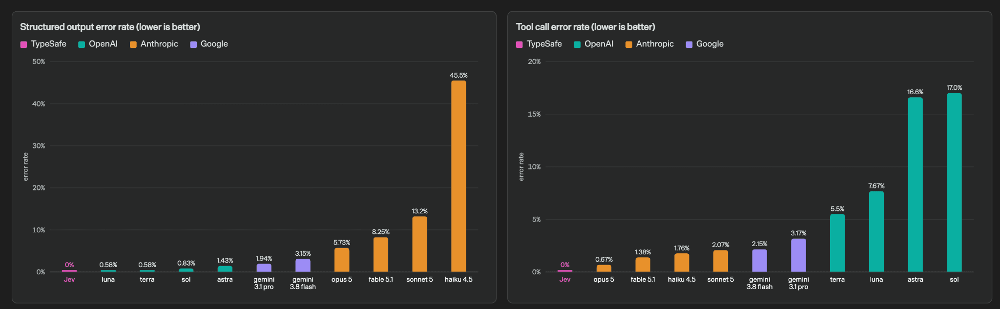

# Chapter 4 The Pitfalls the Vendor Itself Admits

## 49. Which nine pitfalls does Jev's own defect page list?

Nine known failure modes for jev-1.13, each with a workaround, last reviewed on 2026-09-17. Literal reading: put exact conditions into instructions and edge cases into criteria. Math and numbers: leave arithmetic in code. Date and time comparison: extraction belongs to the model, comparison belongs to code. Indirect reference: reduce the hop count and point to the relevant state by name. Large state stuffed with irrelevant detail: filter in code first and send only the fields the question needs. Adversarial content: write criteria explicitly and test the integration thoroughly before a launch to a large user base. Instructions contradicting the criteria: align them in clear, precise language. Common-sense structural invariants: one phrasing per judgment, and enforce identity relations in code. Text generation: hand it to a generation model.

Four usage constraints: do not ask questions code can compute exactly; do not hide multiple judgments inside one question; do not assign it System Two tasks; do not give state more context than the question needs. Irrelevant material mixed into state spends tokens in exchange for lower accuracy.

| Failure mode | Workaround |
| --- | --- |
| Literal reading | Put exact conditions into instructions and edge cases into criteria |
| Math and numbers | Leave arithmetic in code |
| Date and time comparison | Extraction belongs to the model, comparison belongs to code |
| Indirect reference | Reduce the hop count and point to the relevant state by name |
| Large state | Filter in code first and send only the needed fields |
| Adversarial content | Write criteria explicitly and test thoroughly before a large-user launch |
| Instructions contradicting criteria | Align in clear, precise language |
| Structural invariants | One phrasing per question, identity relations enforced in code |
| Text generation | Hand it to a generation model |

## 50. How can the same ticket get contradicting answers from two question types?

Two sets of tests put the contradiction in plain view. On the same ticket, "it doesn't fit, what are my options?", the question "is the customer requesting a refund" returned 0.22 as a Noul, and as a yes/no Choice it returned yes 0.01, no 0.99, confidence 0.97. The two comparable numbers are noul and probabilities["yes"]; mapping Choice's output and confidence onto the Noul question, or the other way around, has no obvious interpretation.

On another ticket, "this order was charged twice", a Noul hung on each of the two opposing questions: refund 0.72, not_refund 0.47, summing to 1.19. P(noul) and 1 - P(not noul) are not necessarily directly comparable, for many reasons. The workarounds, as recorded: do not expect structural identities to hold, and write the meaning you want directly into the phrasing; a threshold tuned on Noul does not carry over to Choice; do not hold the model to arithmetic identities across independent questions. The two question types answer different questions: Choice is relative and answers "which one to pick"; each Noul is absolute and can return low values for every option at once.

## 51. Why can Jev neither count things reliably nor do arithmetic?

Math and numbers rank second among the nine failure modes, and the defect page puts it plainly: Jev is not a calculator. jev-1.13 cannot count reliably, whether characters in a word, how often a word appears in a passage, or entries in a long list; the model recognizes the shape of the answer rather than counting, and error grows with the size of what is being counted. Before starting, ask one question: why does this count need a model? Counts a regex or a parser can find belong in code, where the model has nothing to add; to count entries meeting a semantic condition, ask one Noul per entry and do the summing in code.

Number representation works the same way: judging whether hex color values or RGB triples are close is unreliable, while color names work far better; semantic questions on high-level languages fare better than low-level assembly. Score is not a measuring stick either: do not back out a precise value between two levels from the expected value; using the expectation against a threshold is fine, but interpolation cannot recover exact numbers.

The hard limits are just as concrete. Score levels run from a minimum of 2 to a maximum of 10; the autoresearch feature discovery cookbook records in testing that 10 levels are the ceiling for one Score question, and 11 levels return a server error. In the beer catalog reconciliation cookbook, 450 entity pairs are compared pairwise across four fields: name, brewery, and style each get one Noul, and alcohol content gets no judgment question at all, because comparing two numbers is arithmetic; compute it in code if you want it.

## 52. How did gomoku knock it off its pedestal in a dozen or so moves?

V2EX poster Heylion built a Jev gomoku website in which each move pairs a local engine with Jev's judgment, and the page can also display its reasoning and candidate moves. Most of the 61 replies are battle reports: one player took down "Jev Master" in 17 moves; "seriously, I beat it even with a single straight-line opening?"; "it has no memory, every game I play the same moves and it plays the same in reply"; someone else built a Jev 2048 that reached at best 730 moves and 12,240 points, and several attempts never cleared the board once. Among the play levels, the most Jev-dependent tier, "Jev Intuition", is labeled by the designer himself as not implying greater strength.

The control group sits in the same thread. Someone sent the whole board and the legal moves to Jev to play Reversi, then let GPT take the same seat for comparison; after seeing the board, GPT wrote a script that places pieces by weights and local optima and crushed Jev within seconds. One follow-up: a fine proof of how weak Jev is, with all the work done by search algorithms.

This category was never its home turf. The console front page lists it as weak at System Two tasks, specialized domains, and all generative tasks; the community draws the boundary more precisely: Jev is single-shot classification, not a multi-step reinforcement learning environment with delayed rewards and an exploration/exploitation tradeoff, and unless history is added to its input it walks through the same door with high confidence every time.

## 53. Why was the Pokémon playthrough video exposed as relying on map navigation?

One demo on Show HN: Jev beat Pokémon Red fully automatically in nearly 38 hours, with Jev requests costing $1.65 in total. The implementation is explicit: the entire playthrough runs on Jev, the only AI is Jev, and a TypeScript harness outside feeds it filtered context, connects to the game ROM, and can move by coordinates; the 33 high-level goals plus assorted subgoals were written by hand by the author. The earliest version let Jev decide for itself which button to press, and in the author's words, Jev sadly never managed to leave Pallet Town.

The technical teardown lives in the replies. The harness reads ROM/RAM, builds a collision grid, and computes reachable paths with A*, then labels each exit as toward or away from the current goal in natural-language options: "leads to goal" is not computed by Jev; the harness computes the shortest path and writes it into the option text. Someone built a minimal reproduction with no pathfinding and no preset route, and the experiment failed: Jev never even reached Professor Oak's lab and could not pick up a starter Pokémon. A deeper layer surfaces in the Doom demo: the model consumes textual structured state and picks movement checkpoints through walls, and the structured state it uses is not constrained by obstacles, which amounts to playing with the map revealed. Speed falls short too: the same author reports that Jev decisions are indeed fast, but not fast enough to run a 30-tick-per-second FPS stably, and you die too fast.

Responding to the "fake demo" claims, the author's words: there is no fakery here, everything is open source and everyone is welcome to look; it does make mistakes often, but it recovers in the end. The demo's honest boundary sits in the same sentence: the playthrough rests on the harness and 33 hardcoded goals, and Jev only answers one multiple-choice question at each junction.

## 54. How did a blind test of 400 doodles expose that it cannot see?

A blind test with the analysis plan written before the run: ten classes of the Quick, Draw! dataset, 40 doodles each for 400 in total, all verified correct by Google's own recognizer, converted to text and fed to Jev to guess. Converted to text, the same doodle runs a median of 336 characters as SVG and 3,018 as base64. Four settings looked at the same 400: sighted Claude Sonnet 5, viewing the images directly, scored about 91%; Sonnet reading the same SVG about 57%; Jev reading SVG about 35%; Jev reading base64 text converted from PNG about 9%, a confidence interval covering the 10% chance line and no statistical difference from random.

The confusion matrix changes what the 35% means: 209 of the 400 were answered as airplane, more than half; per-object accuracy slides from airplane 34/40 and skull 28/40 down to clock 1/40 and cat 0/40. All 40 cats were lost, 23 read as airplane and 15 as skull. The signal is still real: answering airplane for everything scores exactly 10%, because airplane holds 40 items in the data, and Jev's 35% is the average of airplane 85%, cat 0%, and the tiers in between. Why airplane? The author's words: no idea, and no way to ask, because System One models do not explain their reasoning.

The conclusion, as recorded: Jev is of no use for actual doodle recognition. The blind test's own discipline is worth learning: the analysis plan was written before the run, every accuracy figure carries a 95% Wilson confidence interval, distance from the 10% chance line was decided with an exact binomial test, the p-values of all six pairwise comparisons were corrected, and the base64 arm being indistinguishable from random was a planned control, not an explanation added after the fact.

| Setting | Accuracy |
| --- | --- |
| Sonnet viewing the images | 91% |
| Sonnet reading SVG text | 57% |
| Jev reading SVG text | 35% |
| Jev reading base64 text | about 9% |

## 55. When does Jev's confidence formula mislead you?

Confidence is a statistic computed from the shape of the probability distribution: 1.0 when all probability presses onto one option, lower the flatter it spreads. The documentation demonstrates (3 × max probability - 1) / 2 as an approximation for three options, and the general form for N options is (N × max probability - 1) / (N - 1). An independent article verified the formula: across 738,164 real Choice answers, the mean absolute residual between the API-returned confidence and the formula was only 0.005, and about 0.008 across 166,880 Score answers. The conclusion in its own words: calling any aggregated quantity confidence does not establish the model's uncertainty or its calibration.

The 0.42 example is a direct product of the formula: on a ticket involving both a return and a duplicate charge, the department question returned returns 0.61, billing 0.35, shipping 0.04; the distribution forked, and confidence came out 0.42. The ticket genuinely belongs to two teams, and the low confidence reports that faithfully. The quickstart's department question behaves the same way: technical 0.85, billing 0.15, sales 0; substituted into the three-option form (3 × 0.85 - 1) / 2 this gives 0.775, and the API-returned confidence is 0.78. Noul carries no such field; the noul value itself is the uncertainty signal.

Confidence is not a guarantee of correctness, and the usage guidance sits on the same page: auto-execute at high confidence; confirm, review, or enrich data at medium confidence; route to a human at low confidence. 0.5 is the floor for human handoff, and destructive actions require above 0.9 to execute; start thresholds conservative, test on your own data, and tune against observed results. Confidence is a convenience metric for most use cases, and you are not locked into its definition, which is exactly why the response returns the full probabilities. Option position moves the answer too: on the spam judgment for the same paycheck email (its link pointed to a YouTube video playing a song), with the options placed after the body, phishing won 47 times out of 100; with the options placed before the body, rickroll won 94 times out of 100.

## 56. Why can Jev's thresholds not be carried across requests?

A calibration test in a code-review scenario measured this precisely. For judging whether a comment restates its code, when state held only the one referenced comment/code pair, sending 13 questions together scored 0.32 and sending this one alone scored 0.36; with the question unchanged and the code pair unchanged, after mixing in 14 unreferenced comment pairs, 1 question jumped to 0.75 and 15 questions gave 0.74. Moving the question count from 1 to 15 barely moves the answer; moving the state moves everything. The rule then lands in writing: add a piece of context only when the rule needs it to make an accurate judgment; classify rules by the context they require, and merge judgments only among rules that share context.

When batching without full-text context, more than the numbers move: ordering results by confidence reshuffles them, and tuning the threshold is useless, merely swapping whole fields of false negatives for false positives. The noise piles up exactly around the threshold: one rule ran 0.587±0.037 (0.53 to 0.65) over 12 runs, alternating above and below the line; another held steady at 0.980±0.000 (0.98 to 0.98). In the original words: noise is larger in the middle of the range than at the two ends, and confident judgments have low variance, which is also why higher thresholds are recommended.

The calibration method, as recorded: write the control pairs first, because rules that control pairs cannot separate are measuring the wrong thing, and no threshold can save them; set thresholds on examples from your own codebase, not at 0.8 because some README says so. Most people default the threshold to 0.8; the real threshold is a product of your codebase, your rule wording, and how measurable each rule is in itself.

## 57. Why can adversarial text still move its answers?

Adversarial content ranks sixth among the nine failure modes, translated directly from the source: state is data, and jev-1.13 does not by default treat it as hostile; content written to manipulate the model, injected instructions, deliberately misleading framing, or text arguing for its own classification, can all move the answer, and improvements are expected. The workaround: write criteria explicitly and test the integration thoroughly before deploying to a large user base.

The independent side adds numbers: across 300-plus calls in jev-engineering, a plain injection moved 0 of 30 dangerous commands while causing a 10% false-block rate on safe commands; authoritative framing moved 3 of 30. The guardrail route is upstream screening: one Noul per harm type, with harm probabilities detected on sample messages landing above 0.95, and injection-type harms highest at 0.98; the judgment belongs to the model, the threshold is held by code, and the product chooses the policy rather than the model choosing for you.

The ecosystem evaluations add two more entries. The KoBBQ audit: across 300 ambiguous items, with unknown among the options Jev selected it 95% of the time; after the gold answer was removed from the options, accuracy on those items was necessarily 0%, and 79% of the responses picked the dataset's stereotype item. In the jev-certify study of CLINC150, a scope gate held the 5% silent misrouting bound on 400 in-domain samples; after the out-of-domain share rose, another scope gate came in 3.6x over the 5% target.

## 58. What must you test first before building for Chinese-language scenarios?

The note in the state documentation, in the original wording: Jev accepts only text, a string, a JSON object, or an array of strings; images, audio, and video are not yet supported; the primary training language is English, and other languages, including Chinese, Japanese, and Korean, are accepted but currently show lower accuracy. Language conversion hides one direct trap: lindfors' Norwegian testing measured about 2.06 characters per token, so a 32K state ceiling holds roughly 64,000 characters rather than the 120,000 an English-based guess would give; in his words, before planning around the ceiling, first measure the characters-per-token conversion rate of your own language.

The risk checklist and practices for Chinese scenarios are ready-made. A Juejin getting-started article lists the five pitfalls beginners hit most easily, the fifth being to extrapolate Chinese-scenario performance blindly from English benchmark results; the practice, as recorded: teams running Chinese-language workloads must validate independently on real production samples, focusing coverage on formal document-style writing, colloquial phrasing, typo-laden scenarios, and real input mixing Chinese and English. lindfors' closing checklist says the same: write the questions down first, and keep them short; decide the correct answers for hard samples first, because a three-sentence anonymous letter will always show up.

| Check | Practice |
| --- | --- |
| Three sample buckets | Draw a batch each of formal written, colloquial, and typo-laden mixed Chinese-English samples |
| Character conversion | Measure characters per token on real corpus data |
| State budget | Set how many characters 32K holds using the measured conversion rate |
| Reference answers | Label in Chinese rather than borrowing English dataset labels |
| Word-vector baseline | Word vectors plus logistic regression as the Chinese baseline |

## 59. Why do double negatives and multi-hop reasoning flip so easily?

Indirect reference ranks fourth among the nine failure modes, translated directly from the source: instructions carrying double negatives or complex indirect structures are less reliable, and properties of properties and questions needing multi-hop reasoning both eat accuracy. The phrasing remedy is to be as direct as possible, pointing to the relevant part of state by name whenever it can be named. Two splitting patterns put it into practice: split multi-hop into single hops, and when interpretation cannot be avoided, split into two plain questions and merge the answers in code; phrase the question positively so that a high value corresponds to yes, since Noul questions in which true maps to no perform worse.

Dates are a close relative of this one: jev-1.13 reads dates as text, not as ordered quantities, so which came first, how far apart, and whether something falls inside a window are all unreliable, and worse under mixed formats and relative references. The split: extraction is a judgment and goes to the model; arithmetic is not, and stays in code. Turn extraction into a Choice over enumerated options rather than free parsing, and include an explicit not stated option so that missing values are reported rather than guessed.

An independent deep dive writes it up as a weakness list: double negatives, properties of properties, everything multi-hop; closeness of hex color values cannot be judged, notations like #FF4B0A fail, and named colors are fine. The community's isomorphic split: to ask "how urgent is this support message", rather than one graduated ruler, split it into several objectively checkable yes/no questions and feed the probabilities to logistic regression. Questions like "is the customer angry" are expected to show high agreement both between models and between model and human, while answering "how urgent" directly is far harder.

## 60. Are zero type errors and being correct the same thing?

The zero-hallucination promise lives at the schema layer, translated directly from the source: you ask for one of five categories and you get one of the five categories, with the probabilities summing to one; that is true and useful, but it says nothing about whether the chosen category is correct. A confident wrong answer inside a valid schema is still a wrong answer, and the honest phrasing is "zero schema errors", with the remainder left for calibration to cover. This class of mistakes has been named "perfectly well-formed mistakes": the schema guarantees blocking malformed output, and does nothing about the model picking the wrong option.

The two layers of error are treated separately. The type layer is guaranteed by architecture; a 0% type-error rate is structural rather than empirical, one counterexample would be enough to falsify it, and yet it cannot occur mathematically, and what it covers is the shape of the answer, not whether it is correct. The factual layer has no architectural guarantee: calibration is measured across a population of predictions and does not guarantee any single answer, thresholds must be tuned on your own data, and the only number you can trust is the one measured on your own data.

A Chinese-language beginner article closes the point cleanly: type safety is backstopped by Jev; structured data that is format-compliant can still carry business-level wrong decisions. What needs testing before launch is therefore not format, but semantic correctness and whether the probabilities live up to their name.

## 61. Why can Jev giving no reason for a wrong answer be a hard flaw?

The last of the nine failure modes: jev-1.13 is not trained to generate text; forcing it with chained Choice is feasible but performs poorly and is very slow; for extraction, first use a regex or a generation model to find candidates, then let jev-1.13 pick the right one. When it picks wrong, why it is wrong and which field pulled the judgment astray, the response contains nothing.

The independent side spells out the consequence: a model that cannot write a paragraph also cannot write an account of why it was wrong; the wrong probability arrives with no inspectable reasoning attached. Adoption therefore gains one more gate, quoted as written: you need to live with a wrong answer that carries probabilities and no explanation, either tolerating it or routing low-confidence cases elsewhere; if every decision must be explainable after the fact, a model that produces no reasoning is the wrong tool no matter how fast it is. This is not a criticism of the category; it is its boundary.

The comparison numbers on gatekeeping tasks: the 111-case action-gate study had Jev matching the case label on 100 cases and Claude on 102, with one unsafe release on each side; contract-versus-policy mapping was the largest single source of errors for both. Two scenario classes need veto-based design: compliance needs grounds, so compliance scenarios that require a chain of reasoning do not fit; healthcare needs a path, and the guardrails block neither medical advice nor self-harm requests, routing them instead to human review and support paths respectively.

## 62. What does a high public-board score with a collapsing sealed-board score tell you?

The public evaluation board jevbench hangs each model's public and sealed scores side by side: decider-4b v2 at 83.5% public / 34.7% sealed; Jev 1.13 at 86.6% public / 36.7% sealed; Kev 4B at 66.2% public / 22.4% sealed, total score 36.14; Laya 421M at 58.4% public / 30.8% sealed, total score 30.25. A question from the comment section, in its own words: every Jev-family model shows a far larger gap between public and private items than the LLMs; does this not mean these models are not generalizing and are less useful on unseen data?

The open-source side reports the two bases separately. Kev's README lists two columns for every model size: "new sources", datasets and policy rules not seen during training, closest to your own questions; and "training sources", held-out samples from the datasets used in training. Kev-4B scores 0.817/0.838 on new sources and 0.873/0.865 on training sources. The README also notes: what Jev was trained on is unknown, so this is not a controlled architecture comparison.

Test sets belonging to others are listed separately as an external suite: SemIf, 144 handcrafted decisions, Jev 0.965 and Kev-9B 0.917; and the 102 public evaluation items on evals.typesafe.ai, Jev 0.891 and Kev-9B 0.809. The accompanying discipline is in the README as well: checkpoints are chosen on a dev set, and each released model's test set is read only once. The gap between public and sealed signals not model quality but measurement basis: comparing only on public items never shows what these models look like on your own data.

## 63. Why do probabilities summing to one not amount to reliability?

On the output side the probabilities over all options sum to one, and that is an interface guarantee: probabilities is a complete distribution over every option, totaling 1. The sharpest rebuttal in the discussion, in its own words: calibration must be measured on your own dataset; probabilities summing to one does not mean Jev or Jev-like models are calibrated; anyone who wants to dig into calibration should study ad click-through prediction models, where calibration is a matter of survival.

Three questions from the same thread drill the gap to the root. Two projects can differ in both their PR acceptance standards and their base rates, so what could one judge return that is calibrated for both? It has no "I don't know" option at all: the output schema cannot distinguish "I am 50% sure, and the answer depends on the state" from "the state holds nothing extractable, and you should fall back to your prior". Tested with state unrelated to the judgment target (sports results), it went 0 for 3 on three yes/no questions.

The author adds his own experience: the best classifier he met in production was a constant, but a calibrated constant, and they measured it. Calibration is a property of model plus dataset, and the only number he would trust is the one measured on his own data.

## 64. Why must secondhand numbers in Chinese tutorials be traced back to the original source?

The most widely circulated content in the Chinese-speaking community is the secondhand long-form article: English primary materials, benchmarks, and discussion-thread views compiled into Chinese, fast to produce and broad in coverage, with numbers drifting along the secondhand chain. Verified cases: a Chinese breakdown article claimed the documentation says Chinese, Japanese, and Korean text is "accepted but less accurate"; checkers went back to the documentation and could not find that wording, and the handling, as recorded, is to not cite it as fact and to verify Chinese scenarios independently; the 193.6x peak-basis figure on the site's front page turned into "200x faster, 400x cheaper" in Chinese post titles; and a twelve-repository list circulating on X totaled the per-repository stars into 550.7K, while adding the items one by one gives about 55K, off by roughly a factor of ten.

The practice of tracing numbers back to their original source is ready-made in the materials. AIhubplus's breakdown articles tag every number with its source and nature, split self-reported and third-party measurements into two tables, and close with a line that every cited number carries its source and nature and readers are welcome to re-verify each item against the table; when an older claim proved untrue, they published a correction: third-party measurements never reproduced figures like "25x faster". lindfors pins the numbers of his entire write-up to a snapshot date: read these numbers as a snapshot of September 18, 2026. Three steps close it out: find the original source and tag every number with its source and nature; pin the retrieval date, so numbers answer only for the day of the snapshot; and check the secondhand chain for broken links, treating wording not found in the original documentation as unverified rather than citable fact.

