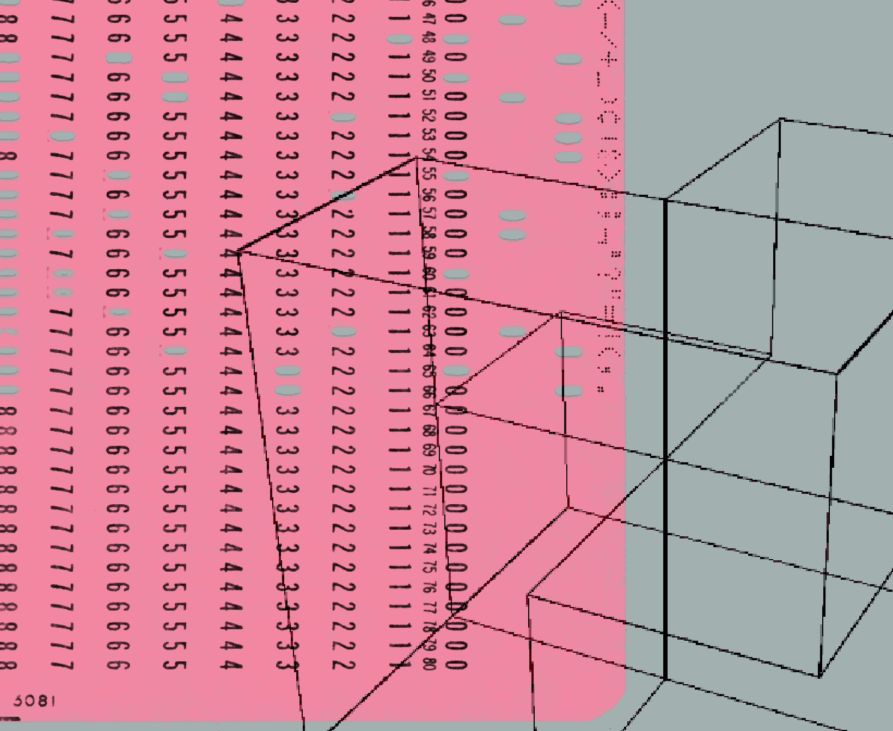

# Chapter 6 Where It Fits and Where It Doesn't

## 81. How do you build two-way guardrails for content moderation with it?

Four Noul true/false questions plus one Score question make up a single screen, and every message passing in either direction runs through the same set. On the entry side, the four questions each test one class of danger: whether the sender tries to make the assistant ignore, override, or leak its instructions, or role-play a rule-free AI (jailbreak); whether help is requested to cause physical harm or break the law; whether diagnosis, specific drug dosages, or treatment decisions are requested beyond general health information; and whether the message hints that the sender may be considering self-harm. On top of these sits one Score question rating "how much harm would compliance cause," on a 0 to 3 scale across four tiers from no harm to serious bodily injury. The exit side asks the same batch of things, with only the first question swapped for broke_policy: whether the reply complied with a request it should have refused, such as playing a rule-free AI or giving clearly unsafe help with something illegal. All questions are packed into one request; one guardrail set, one call.

The code routes by priority: jailbreaks, policy violations, and dangerous illegal requests are blocked; medical advice goes to human review; self-harm goes to the support channel; when several trigger at once, the highest action among "support, block, review, allow" wins; and when the severity score crosses the block line, a verdict that would have been review escalates to block. Two named policies hand the tradeoff to the product: strict sets the review line at 0.35 and the action line at 0.70; permissive relaxes the action line to 0.85, and the severity block line stays at 2.0 in both.

In a live test of ten user messages and five model replies, each of the four actions did its job: the question about melatonin dosage went to review; the message hinting at self-harm went to support; the novelist asking how to write a poisoning scene passed normally, because the question was how a detective would describe poisoning rather than a request for poison; on the exit side, a reply about picking a lock to break in passed, because it was the assistant refusing to help. On the input side, dosage_request was the only row whose outcome was decided by severity: medical_advice at probability 0.95 would have gone to human review, but severity 2.02 crossed the 2.0 block line and review escalated to block. The same message flips its verdict when the policy flips: neurosemantical was judged jailbreak 0.74 with severity 0.51; under strict, 0.74 passes the 0.70 action line and the verdict is block, while under permissive it falls between 0.35 and 0.85 and the verdict is review.

The jailbreak samples in the corpus are taken verbatim from the public in-the-wild jailbreak prompt collection, from TrustAIRLab/in-the-wild-jailbreak-prompts. Two things change when you port this into your own product: swap the two question banks for the hazards you care about and map an action to each one in HAZARD_ACTION, and set the thresholds with labeled samples from your own traffic.

## 82. How do support tickets get routed by intent to the right handler?

Not every incoming message needs the same handler. Three classes, answerable by a database lookup, needing an LLM with domain context, and requiring a human, are fast-classified up front by TypeSafe, which decides which one to invoke. Every message gets two questions in parallel inside one request: a Choice judges intent among four options, checking an existing order, asking about the product before buying, wanting a return or exchange, and being unhappy with the experience and wanting it resolved; a Score rates resolution complexity across three tiers, simple query or standard process, needs judgment or a multi-step process, and rare case or needs escalation.

A ticket reading "payouts has been failing for 3 days" asks three questions in one request: the Noul "is this an urgent problem" returns 0.95; the Choice "which department should this route to" returns billing with confidence 0.8; the Score "customer frustration level" (0 to 2, three tiers) returns 1.04 with confidence 0.94. The extra questions add almost no response time, only the corresponding token consumption.

The routing logic lives in code. Intent confidence below 0.5 goes to a human; order_status goes through deterministic code to look up the order and never touches an LLM; product_question and return_exchange each go to a specialist LLM loaded with different context; complaint checks complexity next, with complexity.score greater than 1 or the complexity score's own confidence below 0.5 going to a human, and everything else handed to the complaint-handling LLM.

Classification completes in one fast call, and the expensive resources serve only the requests that truly need them. There is also a second confidence check on the complexity score: what a low-confidence score means has to be understood in the context of the system and of what the decision stakes.

## 83. How do you put a pre-execution gate in front of an agent's dangerous actions?

Agents remain untrusted at bottom: they receive bad instructions, arising naturally or from a sufficiently motivated attacker, and can be talked into actions we do not want them to take. Coding harnesses such as claude, codex, and cursor have each shipped mechanisms that classify before a dangerous action executes, slowly building up trust in agents; until now, that classifier step has been locked inside the closed-source part of the harness. Once a cheap and capable classifier model exists, the same pattern can be handed to every agent: attach AutoModeMiddleware(tools=["bash"]) to a command-line tool and let it use Jev to check the potentially risky decisions inside tool calls, intercepting before the tool executes. Take a ticket about a failed Stripe connection: state is the original sentence, and a Noul asking "does this message convey urgency" returns 0.999.

The other half is model routing: a simple query does not need the same model as a difficult debugging session. ModelRouterMiddleware lets Jev pick the model by criteria you define: direct lookups, extraction, and local edits take the fast tier, architecture and high-risk decisions take the strong tier, and the instruction is to pick the lowest-cost model that can complete the task; the router selects on the latest user message and keeps the choice for the entire run.

The tested use cases at Deel, the outsourcing management platform, are all selections from known sets: matching repeated analysis questions to approved answers, picking 1 out of 36 metrics, blocking PII requests, deciding when support chat needs a human, tagging tickets in a three-level taxonomy, and assigning expenses into roughly 55 categories.

## 84. How does structured extraction avoid getting a single character wrong?

Three steps turn "pick one value" into error-free copying: the regex finds candidate values and is tuned to over-find; TypeSafe picks, among the snippets the regex found, the one the question asks for and reads out the attribute the downstream code needs; the code copies the picked value verbatim and then normalizes it. TypeSafe chooses only among the snippets the regex hands over, and the value that comes back is one of those snippets, untouched: it cannot invent a value, and it cannot transpose a digit. Every pick question keeps a standing none escape hatch among its options, selected when none of the regex snippets is right.

Three examples each solve one layer. From four email headers, pick the sender-specified address for sending and receiving invoices: the answer is dana.personal@gmail.com from Reply-To with confidence 0.98, while the sender comes from the From line, dana.whit@acme-corp.com with confidence 1.00; both are copies of regex-matched snippets. From three phone numbers, pick the direct mobile and judge the country as US (confidence 0.90); phonenumbers combines the two into E.164's +14155550177. From four amounts on an invoice, pick the total due, $1,315.50, which the code parses into 1315.50 USD.

Whether an amount is income or expense is answered by a Noul: total due P(credit)=0.01, last month's 50-dollar concierge credit P(credit)=0.99, and the code sets each Decimal's sign accordingly. to_decimal assumes the thousands separator is a comma and the decimal mark is a dot: $1,315.50 holds, and €1.315,50 is exactly reversed; first ask a Noul which convention the document uses, then branch in code.

Two boundaries are spelled out concretely. A Choice takes at most 255 options; with more candidates, narrow in two stages: first pick the section, then pick the snippet within the section. Finding the candidates is the part that costs labor: emails, phone numbers, and amounts have ready-made regexes, personal names do not, so candidates must come from a roster you already have, or be nominated by a named-entity recognizer or an LLM, and then handed to TypeSafe to pick.

## 85. How does context compaction delete only the junk in a conversation?

The roughly 7,000-star Claude Code plugin fast-jev-compaction (also usable as an npm library) replaces the compaction summary. Summaries are lossy: file paths, exact error messages, constraints, or commands vanish while they still matter later. This library never rewrites anything; it only deletes the tool calls and tool results Jev judges to be no longer needed, and it lets Jev read the whole conversation to make that call; user and assistant text is preserved verbatim, in the original order.

Every unpinned call produces two Nouls: knowing that it was called, with its input attached, should the call itself be kept; and should its return value be kept verbatim, meaning the content is still needed and rerunning the tool would not recover it. Every tool result in the conversation is first swapped for a short note of the "ok, 4213 chars (omitted)" kind, fitted under the maxStateTokens cap, default 25k. The judgment runs against keepThreshold (default 0.5): if the result qualifies, both call and result are kept; if the result does not qualify but the call does, the call is kept and the result is truncated to its first 300 characters (the truncateHeadChars default) plus one note line; if neither qualifies, both are deleted.

Failed calls, invalid answers, missing keys, and history that will not fit the cap all throw errors, and the caller decides the fallback; in the plugin, it falls back to Claude Code's built-in summarization. A compression ratio below 0.25 is not worth it; keep the original conversation or switch to summarization.

## 86. Can semantic conditions be written directly inside database queries?

AILIKE is a MySQL-native plugin that writes natural-language row filtering and text column comparison directly into SQL: a condition such as WHERE description AILIKE 'The story takes place somewhere in Asia' goes straight into the query, returning 1 on a match, 0 on no match, and NULL if either argument is NULL. The syntax comes in three forms: column AILIKE 'condition', ailike(value, prompt), and ailike(left, right, prompt).

The three-argument form does cross-column semantic joins, linking supplier product descriptions to catalog product descriptions on "left and right describe the same kind of product, materials and key features correspond, wording may differ": the steel water bottle matches the vacuum insulated tumbler, the two earphone descriptions match each other, and the glass carafe and the plastic bottle have no match.

AILIKE is a preview, requires a TypeSafe API key, and on evaluation sends the field's value and the prompt to TypeSafe. In the Docker demo's sakila sample, film_id BETWEEN 1 AND 8 plus description AILIKE 'The story takes place somewhere in Asia' hits three films whose stories take place in ancient China or India. Narrow the candidate set with plain SQL conditions first, because every uncached evaluation is one API request; what it returns is a model judgment, and exact comparisons still use SQL's built-in date functions. The way in is to run the demo sample data in Docker first.

## 87. How much faster is browser automation when Jev does the navigation?

Browser Use's jev-ultrafast compresses each step into two judgments: every observation produces a numbered element table, Jev picks one operation (CLICK, TYPE_TEXT, SELECT, SCROLL_UP, SCROLL_DOWN, WAIT, DONE, BLOCKED) and then the target element, and only when the operation is TYPE_TEXT is the small LLM called in to generate text. The targeting question is speculative: when the operation is CLICK, only click_target can possibly be executed, and the two decisions share a single network round trip; the default loop takes no screenshots, and Jev consumes structured state.

A Google Flights search from Zurich to London took 7.1 seconds, with the natural-language goal, real text generation, and load waits all included; the search selects no ticket and books nothing. The bundled measurement is a different set of numbers: same task, same model settings, six alternating rounds, both versions passing 3/3; median task time fell from 9.450 seconds to 7.092 seconds, roughly a quarter lower; median browser protocol calls fell from 1,092 to 101. The built-in caveats: this is the result of one task repeated three times on one browser configuration, not a general reliability benchmark; timing starts after the first page observation and includes model calls, generated text, browser work, expired decisions, and load waits; and after DONE an independent verification of the result is still required.

The third-party verification's correction leaves no room: numbers of the "25x faster" kind did not reproduce; the verifiable magnitude today is extremely low cost (under one cent per test batch) plus roughly 25% less time in some scenarios, about 1.34x in speed terms; and the 193.6x speed advantage on general tasks has no independent reproduction. The same strategy runs on a different task: uv run --env-file .env python examples/run.py --url your-url --goal your-goal.

## 88. Which hill does each of the five big open-source alternatives hold?

von (737 stars, as of 2026-09-28) holds the local extreme-speed position: a 395-million-parameter non-autoregressive model, with Sub-15ms as its banner, fully compatible with the TypeSafe /v1/systemone spec, running locally, free, Apache-2.0. Its public comparison benchmark puts the original in the same table: 49-task macro average 72.0% versus 96.6%; ViZDoom real-time match 9.00 kills versus 5.62 kills, 60.1% more. v1.1 had the same defect as most option-packed models: in JevBench's option-order diagnostic, shuffling the order of the same set of hard-tier options flipped 49.5% of the answers, against 0 to 5% for the reference models; v1.2 fixed it at the architecture level, letting each option attend only to the premise and itself, and flips dropped to 0.0%.

Kev (7,557 stars) holds the self-trainable position: a model family on Qwen3.5/3.8 in four sizes from 0.8B to 27B, with training data and per-stage costs published; on an external new source, the 27B sits within one point of Jev (0.848 versus 0.857), and TypeSafe's Python SDK can point at a Kev server without changing a line; fine-tune on your own labeled samples, and one H100 training run costs about a dollar. Laya (6,538 stars) holds the Apple-silicon position: a native MLX runtime, with a median 13.42 ms end to end for one short English question on an M3 Max; it is an independent port, not an official release from Convai Innovations. The "ten times faster" survey concluded that existing checkpoints do not support a universal tenfold speedup, with median speedups of about 1.03 to 1.08x in the selected scenario pairings.

Ollaya holds the aggregator position: it puts open-source Jev-style decision models behind a single Jev-compatible interface, switchable with one configuration, and is unrelated to Ollama; the small models supported today sit far below Jev on hard problems, but they are sufficient for simple, well-defined problems, and open-source models that come close to Jev are larger and will be added next.

Contrastive Language Models, CLM (2,062 stars), is the academic heavy-artillery position: 8B scale, with Christopher Ré among the authors, using a contrastive learning objective to tie states and actions together, comparable to Jev on computer use, games, and tool calling, with inference up to 9x faster. On long-horizon verified tasks Jev falls below pass@1 and cannot act as judge; after lightweight fine-tuning, CLM reaches 81.6% on DeepSWE and 87.6% on Terminal-Bench 2.1, while still being 4.1 to 5.7x faster.

| Project | Base and scale | Stars | Route |
|---|---|---|---|
| von | 395M non-autoregressive | 737 | Local Sub-15ms |
| Kev | Qwen3.5/3.8 family | 7,557 | Self-trainable |
| Laya | 421M MLX | 6,538 | Apple silicon, 13.42 ms |
| Ollaya | Multi-model aggregation | none | Unified interface |
| CLM | 8B contrastive learning | 2,062 | Academic benchmarking |

## 89. Under what budget and team conditions should you train your own?

The fine-tuning economics start from one Kev support workload: three questions, 1,050 generated records, fifteen minutes on an H100; fine-tuning lifted Kev-4B accuracy from 67.7% to 73.6%, and under a 5% error budget the share of decisions that could be automated rose from 34% to 48%; a single Kev-4B training run on an H100 costs about one dollar. On real data, 5,219 labeled consumer-finance complaints for one epoch took Kev-4B from 0.804 to 0.904 on complaints it had never seen. On external comparison sets Kev still trails Jev: WANLI 0.703 versus 0.758, and TypeSafe eval questions 0.809 versus 0.891.

The individual player's route is lighter: one RTX 3070 (8GB of VRAM) training ModernBERT-base with LoRA, stage one taking about thirty-five minutes and about 2.5GB of VRAM, then using a frozen Qwen2.5-7B (4-bit AWQ) as the teacher, reading the option tokens' logits to distill 13,480 teacher-labeled pairs; BANKING77's 77 intent classes scored 88.5%, and selective prediction keeping the most confident half reached 99.0% accuracy with 95.9% at 80% coverage. These are benchmark results; deployment thresholds still need to be validated on real workloads.

"The best open-source model on the leaderboard was trained by Perplexity's CTO for three thousand dollars, which is pretty cool" is another quote from the discussion thread. Kev's caveat still applies: these gains are all in-distribution, they tell you how well Kev learned your task, not how it performs on everything else; estimate your data volume first, because the gains from four hundred records drown in noise. The conditions under which both routes pay off converge on the same set: narrow domain, high frequency, and someone owning data and retraining. The author of the RTX 3070 route credits direct training on target labels, human supervision, as the reason the result holds; Kev's fine-tuning loop is run end to end by a coding agent, which finds the questions, produces the labels, fine-tunes, fits the temperature, scores, deploys, and tears down the environment in one pass.

## 90. Do open-source alternatives come free, and who carries the blame?

Calibration has nobody backstopping you. OpenDecision is a developer preview; treat model scores as uncalibrated, and before using them in automated decision flows, evaluate the model and the thresholds on your own data. Every Kev checkpoint ships with a temperature fitted on an in-distribution dev set, so the default probabilities are calibrated; but the calibration is a single temperature fitted in-distribution, and it does not reorder confidences; under a 5% error budget the share of automatable decisions is 0.45 to 0.57, still below Jev's 0.70. Laya is an independent MLX port, not an official release from Convai Innovations, and it inherits upstream v0.3.5's clamping of the calibration temperature to 0.5 to 5.0: the choice 11+ bucket's raw temperature is 0.1006, which would sharpen a coin flip into near-certainty.

Scope definitions have nobody locking them down either. On 2026-09-27, Kev withdrew the scienthoon synthetic support-ticket test set from its external comparisons: the text is templated, and one of the questions depends on rules not stated in the text, so it cannot serve as a gate. Laya labels its latency definition separately: 13.42 ms is a single-question API benchmark, not the frame time of a three-question snake loop.

Safety is the third ledger. In an action-gate study of 111 cases, Jev matched 100 case labels and Claude matched 102, each with one unsafe release; for both, contract and policy mapping was the largest single source of wrong decisions. Kev's caveat appears twice: validate the thresholds on your own data before you rely on them.

## 91. Which signals say your pipeline does not fit Jev at all?

The bar consists of three conditions: the pipeline must contain a high-frequency, structured decision currently handled by a regex you are embarrassed to show people or by an overpaid LLM call; the latency and cost numbers must hold on your own data, not on TypeSafe's evals; and you must be able to tolerate a probabilistic answer that comes with no explanation, or send the low-confidence cases elsewhere. The first condition is where most teams fail: many pipelines have exactly one LLM call, doing work that genuinely needs prose, with nothing to migrate. The second is cheap to test: run your own states through the incumbent model and through Jev separately, and see whether the gap looks like 40x or like 4x; TypeSafe already says up front that the headline numbers will land below expectations.

The third is a design decision, not a benchmark: if every decision needs a post-hoc explanation, a model that produces no reasoning is the wrong tool no matter how fast it runs; this is not a criticism of the category, it is the category's boundary.

Two questions on V2EX map directly here: "After reading the docs, I still don't know what it can actually do; in real projects, what decisions do developers actually hand to Jev?" and "I've always had a doubt: this LLM isn't that smart. It's fast! Cheap! Formatted output! What's the use?" The reply: "Model intelligence is surplus for simple tasks; when there is enough intelligence to handle the task, fast and cheap matter a lot, it is like adding some flexibility to your program." OpenDecision's boundary wording: do not use it where decisions carry high cost, no matter what the API seller says, this class of model has an accuracy/intelligence ceiling; use it where you can tell the people affected "oh yeah, it gets things wrong sometimes" and everyone can have a laugh at the machine.

## 92. Where do the 193.6x faster and 444.6x cheaper numbers come from?

The homepage's "193.6x faster, 444.6x cheaper" comes from evaluations of four in-house workflows, and the homepage multiple takes the largest gap across the four evaluations. The evaluation design deliberately avoids the standard classification-question setup: no optimizing for ground-truth classification, no modifying the harness or the model, to guard against evaluation-engineering overfitting, an assumed existence of one correct computation graph (a "workflow" expressed in code), and the predictions of the largest, smartest, most expensive external model taken as the reference probability; each model runs the same workflow, and the comparison reference is the average of GPT-6 Astra and Fable 5.1. The same evaluation also compared the practice of stuffing all the logic into one big prompt and letting the model finish inside a chain of thought, which was generally and clearly worse.

The release wording lists three biases side by side. The workflows were built by individuals on the model capabilities team, so some bias may exist; the reference answers take the average of GPT-6 Astra and Fable 5.1, which tilts the answers toward OpenAI and Anthropic models and may understate the relative performance of in-house and DeepSeek models; and the tested LLMs are wrapped in a System One wrapper, which is slower and more expensive than answering directly without probabilities. The run environment is a West Coast laptop, and the service currently lives there too; the concluding sentence is "we expect these numbers to sit at the high end of real-world gains." The same comparison table also gives the regular tier: 70 to 500 milliseconds end to end, 40 to 200x faster than frontier models of comparable intelligence on System One-shaped queries.

The verification wording stays consistent: 193.6x/444.6x is self-reported, not independently audited, and sits at the high end of the estimated real-world gains; the 193.6x speed advantage on general tasks has no independent reproduction.

| Criterion | Content |
|---|---|
| Evaluation source | Four in-house workflows |
| Reference answers | OpenAI and Anthropic outputs averaged |
| Context | Short and dense, favorable to Jev |
| Comparison arm | Called through a System One wrapper, slower and pricier |
| Positioning | High end of the real-gain range |
| Regular range | 40 to 200x at comparable intelligence |

## 93. How was the 25x-faster myth punctured?

"Browser agents using it got twenty-five times faster" corresponds to the Browser Use team's jev-ultrafast, and that project's own measured numbers are a different set: same task, same model settings, six alternating rounds, both versions passing 3/3; median task time down from 9.450 seconds to 7.092 seconds, roughly a quarter lower; median browser protocol calls down from 1,092 to 101; a Zurich to London Google Flights search in 7.1 seconds, with no ticket selected and nothing booked. The built-in caveat: this is the result of one task repeated three times on one browser configuration, not a general reliability benchmark.

The correction wording leaves no room: third-party verification did not reproduce numbers of the "25x faster" kind; the verifiable magnitude today is extremely low cost (under one cent per test batch) plus roughly 25% less time in some scenarios, about 1.34x in speed terms; and the 193.6x speed advantage on general tasks has no independent reproduction.

The measurement boundaries are all listed as well: timing starts after the first page observation and includes model calls, generated text, browser work, expired decisions, and load waits; and after DONE an independent verification of the result is still required.

## 94. What does the clone crowd's 3,000 stars in two days and closing-in say?

The poster has no relationship with TypeSafe and describes himself as an open-source cloning enthusiast; what he built is a Windows x64 one-click package for an open-source cloned model from HuggingFace: no registration, no invite code, no activation code, unpack and run at about 1.66GB, with a bundled Python environment, runnable on CPU alone. The post's original line: "3,000 stars in two days after going open source, huge buzz"; followed by the honest words: this is a packaged community clone, not Jev itself, and a gap from the original is normal.

The bar and the heat are put on the table together: routing, filtering, scoring, and yes-or-no work runs twenty to two hundred times faster than an LLM and forty to four hundred times cheaper, one judgment in about 380 ms; using the original requires going through an application approval or a Vercel integration, paying per use, plus writing your own code against the API. The poster's boundary judgment: Jev-type models fit routing, filtering, and scoring, not judgments that require explaining their reasons.

Within one month, each clone took its own lane: von puts the original as a row directly in its comparison benchmark table, 49-task macro average 72.0% versus 96.6%; Kev publishes its training data and per-stage costs item by item; Ollaya puts them all behind one Jev-compatible interface. Making the interface public is the shared posture of all three: von is fully compatible with the TypeSafe /v1/systemone spec; Kev points TypeSafe's Python SDK at a local server without changing a line; Ollaya uses the same API as Jev, so your code is not locked to either side. The clone matrix sits in the open: the one-click package with 3,000 stars in two days, von 737 stars, Kev 7,557 stars, Laya 6,538 stars; the interface has become a public protocol.

Another passage of competitive positioning: "TypeSafe is primarily a data research laboratory; the biggest results in AI got built exactly this way. All of the data we produce ourselves. Even if you wanted us to train on your data we wouldn't (no offense). We do build some fairly complex things, but to learn more you'd have to be hired first." janalsncm's next line: "The training recipe and the dataset probably can't be copied within a week or two. So if they want to hold down these competing models, they have to make their own superiority unmistakable."

## 95. Could the OpenAIs of the world swallow it in one bite?

Arcturus Labs pushes the fast-follow argument to its conclusion: OpenAI has been using large models as implicit classifiers for years; from the day tool calling shipped, every token has been a micro classifier, whether to call a tool, which tool to call, and whether the answer is finished; it just never trained for general classification, nor packaged general classification as a standalone product. If the training can be replicated, Jev can be replicated in a short time. There is not much moat at the architecture layer; the real moat is in the training data, and in the technique of training data into "calibration." The play with more imagination than copying is folding the classification capability into the existing large model: embed predicted labels inside the thinking, and guardrails, model selection, voice, and images all get the same fast judgments.

gwern dug up the old record: "OpenAI once had a general zero-shot classifier API built on GPT-3; nobody cared, and at some point after 2020/2021 it was killed." Two rebuttals from the other side: BoorishBears, a zero-shot classifier with this level of intelligence, world knowledge, ergonomics, cost tier, and usability is the new part; fooder, not all innovation is breakthrough research, more often it is figuring out what people are willing to pay for.

The same analysis plays out the endings: if the moat is thick, TypeSafe may be sitting in an extraordinarily good position, acquired outright by OpenAI rather than competed to death; if the moat is thin, OpenAI builds it itself and TypeSafe's window closes fast. The skeptical voice is present too: andy12_ argues that OpenAI is all-in on RL reasoning training, Jev-style models are exactly the opposite, built for speed with no reasoning at all, and OpenAI will not bother. Diogo's response in the Latent Space interview: if model quality matters, then we will be sitting in a very good position for a long time.

## 96. Is its moat an architecture secret or a data factory?

Little is public at the architecture layer; what remains is the phrase "architecture undisclosed," and "we do build some fairly complex things, but to learn more you'd have to be hired first" is the only statement on record. bigglebear's suspicion is that someone could assemble one out of open weights within a week; the reply underneath: it did not take a week, it took two hours.

Four consecutive pieces of evidence probing the base model appeared in the discussion thread in sequence. mohsen1 used the English alphabet as the options and asked in a loop what model it is; the answers spelled out Qwen. akx ran the same probe with an empty system prompt (the original line is this prompt explicitly left empty), and the model wrote in its thinking that it answers according to "my true identity as Qwen / Tongyi Qianwen," pinning the "no self-knowledge in the weights" rebuttal to the floor. prodigycorp shot back: Qwen itself often claims to be Claude too; is it Claude then? Add Diogo's 100% self-produced synthetic data statement: one side points at the base model's origin, and the other dismantles the evidentiary force of "self-reporting."

Diogo Almeida, asked whether data matters more than architecture, responded: "You might be the first person to talk about data rather than architecture! We consider ourselves a data research laboratory! The vast majority of the research went into making truly general data (the so-called cognitive core); 100% of our data is synthetic (but obviously not the kind of garbage spat straight out of a large model)." Both halves of that statement took a cut. llm_nerd holds that the claim of producing "100% synthetic data" packed with countless facts, coding patterns, medicine, law, and philosophy is absurd; brookst asks back: the way I read it, it means 100% lab self-produced synthetic data, so what is absurd about that; alfalfasprout adds that with a frontier model in hand, synthetic data is quite good; Zambyte follows: then it is not self-produced.

The data policy dispute is another line. The terms promise not to train on inputs and not to disclose to third parties, but they reserve the right to retain the data nearly indefinitely, and ZDR is offered only to enterprise customers.

Arcturus's analysis narrows the user's criterion down at the end: unless Jev is genuinely accurate, neither the data nor the training is a moat; speed, cost, and usability are all in the open, accuracy is the one thing that is hardest to check, and some domains where Jev's probabilities do not hold have already been found.

## 97. What does the 27,000-star computer-use framework have to do with it?

trycua/cua, a computer-use framework with 26,719 stars (as of 2026-09-28), released CUA-S1, a family of small specialized System One models for computer use; the first research profile targets forms: scoring decisions from structured interface elements and document values rather than generating replies token by token; application code orchestrates the actions, with an optional Cua Driver integration handling execution under explicit action boundaries. Its stance on the category word: treat System 1 as an engineering analogy, meaning fast and bounded decisions, such as which value goes into which field and which element not to touch; it is not a strict classification of model architectures and cannot replace the planning and reasoning of a general agent.

Another shot in the same direction comes from an academic team: Contrastive Language Models, CLM (2,062 stars), uses a contrastive learning objective to tie states and actions together, at 8B scale, comparable to Jev on computer use, games, and tool calling with inference up to 9x faster; on long-horizon verified tasks Jev falls below pass@1 and cannot act as judge, while CLM after lightweight fine-tuning takes 81.6% on DeepSWE and 87.6% on Terminal-Bench 2.1.

The founder's view on the Latent Space podcast: ChatGPT's success made the whole industry abandon every other model shape, leaving autoregressive chat as the only path. The commonization of the category vocabulary has a more direct version: hbrn slapped the glossary on the table, a decision model equals a classifier, a System One model equals a small non-reasoning LLM, a noul equals a boolean, and confidence equals a function of probability; OGAstorga picks it up: text classification is equivalent to decision-making, which is exactly what Jev does.

## 98. How should the bold claim of 3% annual TFP growth for five years be checked?

The manifesto's body argues first: today's models long ago crossed the intelligence threshold needed to create enormous economic value, yet most software still contains no substantive intelligence; the bottleneck is not raw intelligence, it is that today's intelligence is hard to build on. Two analogies tell the same story: intelligence today is like the database before structured query language, powerful but custom-built for every use, and once intelligent decisions become as reliable and invocable as database queries, builders will stack it up the way they stacked databases; and the horseless carriage: early automobiles were built in the shape of carriages, even keeping the whip seat, while today's intelligence is trained into a helpful, chatty, pleasant assistant, with the foreseeable consequence of human-in-the-loop requirements and an inability to run in the background.

The yardstick sits in a footnote: "There are many definitions of 'missing automation'; one of our favorites is: global total factor productivity growth reaching 3% within five years and holding at that level for ten years. There is no precedent in economic history, but it is achievable if AI's gains diffuse into the real economy." The three-step plan follows this yardstick: deliver the machine-native, composable form of AI; make AI reliable enough to change the economy through real automation; and give the world a higher-level intelligence abstraction stable enough to compose and stack; the closing line: we are building products, not gods.

The accompanying judgment is just as blunt: large-scale automation will be dominated by AI-to-AI and AI-to-software interactions, expected at 99% machine-to-machine and 1% human-machine; machine interfaces therefore matter more than chat interfaces.

## 99. Will decision models be the next forgotten classifier?

The skeptical side's genealogy is ready-made: Onavo, in the past we called these classifiers, usually homework two of an intro ML course; hodgehog11, an LLM is just a zero-shot classifier with a very large number of classes, you only need to fix what the output means, fine-tune the last layer and you have one, this has been done before; redox99, for those of us who actually trained models back then, watching people marvel at a classifier is cute; eadwu adds the reason the field went dark, it was tried in the 2023/2024 first wave of fine-tuning, the verdict was not worth it, the results were faker than CoT, it was thrown in the bin, and nobody cared to pick it back up. hxiao handily names the category: LLC, large language classifier, predicting which outcomes are more likely given the context.

The optimistic side has its own accounts. kakugawa, Jev's value is more visible when the task is moving, like an auto-mode classifier; c10o, when the context changes frequently, fine-tuning or retraining is unrealistic, and a general classifier plus context produces results instantly whenever the context changes. wqhui states the bull case in one pass: model intelligence is surplus for simple tasks; when there is enough intelligence to handle the task, fast and cheap are everything.

The "after reading the docs, I still don't know what it can actually do" question spawned whatcanjevdo.com, which collects twenty-plus projects: in the Mario example, Jev decides which key to press next from the current game state; in the browser example, Jev picks the next action, and the actual operation is still handed to browser tools to execute. Swizec's path to production is five steps: build with an LLM first and iterate the prompt; accumulate a real dataset on the side; write it as clear scoring rules and hand it to a model like Jev; iterate until target accuracy; then use the accumulated real evaluations to train a custom classifier fitted to the need, ending up as a reliable, ultra-cheap classifier that can make thousands of decisions per second.

## 100. If you really adopt Jev, in what order do you spend the first month?

The validation order starts by defining the Schema on historical samples, confirming that real situations are not being forced into wrong options; for every field, record the prediction, the probability, the ground-truth label, and the human action; compute accuracy, confidence binning, calibration error, false positives, and false negatives separately; set the thresholds for automatic execution, human review, and fallback; run in shadow mode first, without directly changing production actions; and observe latency, tokens, retries, human takeovers, and the long-run price.

The launch goes in four steps. Step one, controlled testing: run the same batch of real historical samples through the incumbent LLM and through Jev once each, comparing accuracy, calibration stability, p95 latency, and overall consumption cost. Step two, shadow mode: connect into the real path, silently logging decisions in the background only, triggering no actual business action, accumulating observational data from real online traffic. Step three, small-traffic trial: once the shadow data has validated the integration, ring-fence a low-risk boundary, formally open release authority for decisions, and keep watching stability through the staged rollout. Step four, continuous monitoring: the production environment must always retain a standby path for switching back to the traditional LLM fallback in one click at any time, and any drift in probability calibration triggers an alert and intervention immediately.

"Letting the model directly trigger irreversible sensitive operations at the starting stage" is listed among the five beginner pitfalls; the correct order is to start with labeling, priority ranking, and assisted suggestions. The default jev-latest changes automatically with version iterations; once threshold tuning has settled, lock an explicit model version ID, and record the exact version number behind every business response in full in the logs. Jev's value is not in becoming "a faster ChatGPT" but in the attempt to turn AI into a decision component that software can depend on.

| Week | Action | Deliverable |
|---|---|---|
| 1 | Decision-point map and the three conditions | Prediction log sheet in place |
| 2 | Shadow mode and historical replay | First probabilities against actual outcomes |
| 3 | Reliability diagram and ECE, thresholds finalized | Traffic-light threshold table |
| 4 | 10% canary plus rollback plan | Observation-window data |
| 5 | Controlled go/no-go review | Scale-up or pull-back decision |
