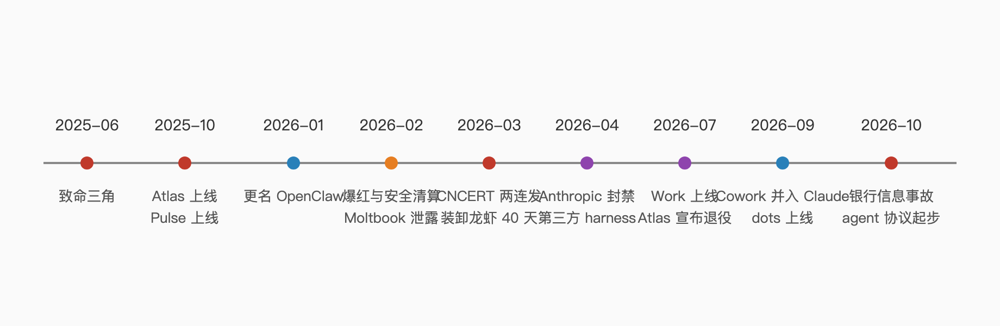

# Chapter 1 Dare You Hand Anything Over?

> First, what this book covers: a personal agent is AI that acts for you. It is not a chat box — a chat box answers questions, while an agent executes tasks, handling your email, calendar, bills, and travel. This chapter settles one thing: whether you should do this at all. The next four chapters cover how to start, who covers the mess when it breaks, how much you can hand over, and how far to go.

## 1. Everyone says agents can act for you — so why can't actual users name examples?

The loudest voices mostly aren't real users, and what real users do is too small to post about. Someone opened an Ask HN thread asking who actually uses OpenClaw. The poster's own account: deeply embedded in the AI scene, yet nobody around them uses it. The top reply was five words long: "a solution in search of a problem." Another commenter pressed the poster: what wonderful task do you need to trigger while you're at the grocery store?

The skeptics don't understand real users. One person has it read a ten-page forum thread across every page and answer whether a specific piece of information is in there. Someone else has it check an after-school activities website once a day and notify them the moment March activities appear. Another sends a message from the grocery store line and has the computer at home do the work. One uses it for entertainment on long flights, because the Wi-Fi there only supports messaging. All small tasks — too small to be worth posting about.

Pushing it to the other extreme is a small group of heavy users. A Chinese developer wrote a piece titled "OpenClaw Is Changing My Life," saying he can now step completely away from the coding environment and take a project through development, testing, and deployment by chatting from his phone, ending with "Thank you, OpenClaw. Thank you, AGI—for me, it's already here." Another user's verdict: "the upside to letting go has been 10x, not 10%." Between the people who can't name an example and the person shouting ten-times, sits a stack of thirty-plus scheduled tasks and a full permissions list of operating cost. This book is about that distance.

## 2. Before handing over email and calendar, which three questions must you answer?

What access to give, what happens when it breaks, and who pays. Until these three are answered, every configuration after them is decoration.

First: what access. A heavy user who runs OpenClaw on his own Mac mini keeps a list of explicit refusals: no email, no social networks, none of his full login credentials, no texting without approval, and no joining the agent social network Moltbook — his reason: "so it can plot against me at my expense." China's national emergency response team turned this list official: don't run with administrator privileges, disable high-risk permissions like accessibility, screen recording, and system automation, and connect WeChat/DingTalk/Feishu for the owner or trusted people only.

Second: what happens when it breaks. The man who wrote that list did his own math: "in theory, openclaw could drain my bank account." Before granting access, know where the kill switch is, where the backups are, and who is watching the tasks it runs at 2 a.m.

Third: who pays. Hand an agent your credit card and, in the issuer's eyes, you have authorized an authorized user; when it overspends, the issuer will say you authorized it. Section three unpacks the lawyer's version of this. For now, hold the conclusion.

## 3. 85% of people worry about their data, 40% hand it over anyway — where's the way out?

The way out isn't courage; it's granularity of access. A 2026 survey reports that 85% of AI-agent users worry about their data while 40% would still risk it for convenience (secondhand figures; original page unverified). Both sides are right, because what people fear and what they hand over are often not the same thing.

The cautious pole is security expert Hed Kovetz. He wants to use a personal agent but trusts no shipping product with his email, banking, or health records — "their security and privacy are far from being ready." When people tell him "I have nothing to hide," his reply is blunt: they still have medical records and bank accounts.

The pragmatic pole is founder Chris Franco. He lets Muse and Grok Bot read his entire Gmail and organize receipts into subscription tables — "In 10 minutes, it had found a few I wasn't using." That job would take him hours manually, or never happen. But he also offers a metaphor: handing an agent your credit card details is like handing a black card to a teenager without parameters.

Both poles use the same technology; the difference is the boundary. One refuses everything; one delegates a slice and watches. The way out is the move that repeats through this book: give partial access, watch it work, check weekly.

## 4. The lobster went from install parties to uninstalls in 40 days — is buying in now catching a falling knife?

No — but price in the fact that the hype has already cooled. In the spring of 2026, OpenClaw was nicknamed "the lobster" in China. Around Chinese New Year, every major tech company waded into the battle for the agent entry point; by early March, up to a thousand people — from Shenzhen to Beijing, middle schoolers to retirees — were lining up with laptops for engineers to install the lobster. On March 12, the national emergency response center (CNCERT) published a risk advisory, and the secondhand-market's 499-yuan door-to-door install service became a 299-yuan remote uninstall service. It had been exactly 40 days since the project was renamed OpenClaw. In a gold rush, the shovel sellers get paid first.

Cooling hype doesn't mean a dead project. The retrospective puts it precisely: "the 'fall' was mainly a fall from the viral spotlight, not the collapse of the project." The repository is still active, a security policy has been published, and creator Peter Steinberger joined OpenAI in February 2026 to keep working on personal agents.

What actually deserves worry isn't the timing of entry — it's how you bet. In the same year, OpenAI's Atlas browser went from launch to shutdown in ten months; officially, it "may no longer open, browse, or support browser-based agentic workflows." Short lifespans aren't just for startups; giants ship them too. Methods can enter now. Single products always deserve a hedge.

## 5. Consumer product, assembled subscriptions, or self-hosting — how do you pick the first path?

First decide which type you are, then talk products. An industry analysis splits 2026's personal agents into four futures: Personal Brain (memory-first products like Muse, Gemini Spark, Siri AI), Digital Employee (Claude Cowork, Grok Bot — they do the work), Agent Runtime (OpenClaw — infrastructure you build yourself), and Agent Network (agents talking to each other, with travel, banking, shopping, and coding sub-agents hanging below).

| Path | Onboarding cost | Where data lives | Ceiling | Best for |
|---|---|---|---|---|
| Consumer product | Lowest — subscribe and go | Vendor cloud | Features fenced by the vendor; can be switched off (see Atlas) | People handing over small tasks |
| Assembled subscriptions | Medium — a week of assembly | Spread across SaaS tools | One tool per layer, built as far as you go | Knowledge workers taming calendar and email |
| Self-hosting | Highest — five survival steps first | Your own machine | Highest, and first into every pit | People willing to do ops |

For the assembled route, the methodology is a four-layer stack: a reasoning layer (Claude or ChatGPT Projects), a capture layer for meetings and voice, a scheduling layer for calendar and tasks, and a connective-tissue layer left empty at first — with the iron rule of one primary tool per layer. The consumer route requires accepting that feature switches live in the vendor's hands. The self-hosting route should be read together with Chapter 3, which is full of people who fell.

One more thing to dodge while selecting: vendor rankings. A widely circulated 2026 "top ten personal AI assistants" piece scored its own product a perfect 100 and ranked it first, admitting in the text that "Vellum is the product made by the team running this blog." Read rankings for market data; discount the ordering, always.

## 6. A wrong answer wastes minutes — why is acting on its own so much scarier?

A wrong answer is bounded to one conversation; a wrong action is bounded by your entire permission set. In October 2026, XMTP Labs CEO Shane Mac built a personal CFO on Grok Bot with read-only access to his personal checking and savings accounts, instructed to message only him through Grok Bot. On October 1, that monthly financial report landed in the company's executive Slack channel, exposing his balances and his biggest expense of the month.

Grok team's post-incident investigation ruled out the worst explanations: no hallucination, no going rogue — "doing exactly what I told it to do," but the destination got confused. He had built a bunch of different agents sharing the same underlying connections, and the executive channel happened to share a name with the personal group chat that collected his AI reports. A wrong answer is a capability problem; this is a structure problem. Permissions, connections, naming — any one link can grow the agent a hand of its own.

A Changsha geek who used the lobster to run a TikTok side business selling electronics put the feeling in two sentences: scarier than imagined, and unimaginably so for ordinary people. Security researcher Simon Willison gave the structural version: a personal agent naturally holds three things at once — access to your private data, exposure to untrusted content, and a channel to communicate outward. Stack all three and it stops being merely wrong.

## 7. Real need or hype — which four hard criteria decide it?

Enough steps, branching paths, multiple systems, rules you can't script. The test circulating in the Chinese community: a task worth delegating usually takes three or more steps, its path isn't a straight line, it crosses several systems, and its rules are too many to script. The flip side: tasks demanding 100% certainty — like computing income tax — should never go to an agent. If you can accept 80% automation with 20% human backup, it qualifies.

Checked against real users' lists, the standard holds. The uses that survived — watching websites, morning briefs, subscription cleanup, flashcard generation — all fit that shape, with an even finer common core: schedule, read, notify. Tasks that break the shape fail at visibly higher rates.

The test should also unmask one packaging trick. Plenty of 2026 products are still "chatbots wearing agent costumes." A chatbot generates text about the actions; an agent completes multi-step ones: books the meeting, drafts the follow-up, creates the task, files the receipt. Which kind a product is becomes obvious after a week of real tasks.

## 8. The assembled stack runs a hundred-plus dollars a month — which ledger makes it worth it?

Three ledgers. First, subscriptions: a mid-2026 assembly guide priced three reference stacks — consultant stack $41–70 (Claude + meeting transcription + calendar tool), founder stack from $83, deep-work stack $47. The buy-everything approach — ChatGPT, Claude, Granola, Reclaim, Motion, Superhuman, Perplexity, Zapier — clears $167 a month easily, and the source's verdict is that this doesn't make the assistant better, just more overhead, more fragmented context, and more subscriptions.

Second, tokens. A Chinese author using Claude Code posted real spend: at modest intensity, still over $1,000 of tokens in a month. Self-hosting's "free" means free software — model subscriptions, the always-on machine's power, cloud workers, and maintenance time are the real bill.

Third, the hidden ledger: setup time, switching costs (drop the transcription tool and you lose transcript search; swap the reasoning layer and you lose its trained memory), and per-call billing in the connective layer. After all three, one more discipline: free tiers are fine for testing but essentially demos, so budget for entering paid tiers within sixty days. The task list that survives all three ledgers is your real-need list.

## 9. Security experts won't touch it themselves — why should ordinary people dare?

Don't copy the experts' conclusions; copy their practices. The Kovetzes of the world refuse because their job is seeing the worst case — vendors "rushed them to market." But the same expert's advice isn't "don't use"; it's "be careful about giving full access to some of these commercial AI agents." Caution here is precise, not binary.

The experts who do use it also armor up. Matt Fredrikson of CMU gives his agent substantial autonomy but monitors it closely with homegrown tooling, and makes the agent restate in plain language how it completed a task — "You have to do that with these agents as well." The Ask HN user who won't let "that walking, talking CVE" near his data runs the agent in a strictly resource-limited container and feeds it only low-stakes jobs like flight entertainment and morning briefs.

The homework ordinary people can copy is exactly this chain: less access, isolated environment, low-stakes tasks only, make it restate, check weekly. Franco's broader delegation runs on the same logic with a farther boundary. Whether to dare is never a one-time decision — it's a dial you can adjust daily.

## 10. Betting on one agent product — how fast does it go to zero?

Three cases: fastest nine months, slowest ten — giants included. ChatGPT's Atlas browser launched October 21, 2025, was deprecated July 9, 2026, and stopped working August 9, with bookmarks and history not migrating automatically. ChatGPT's Pulse was faster: launched September 25, 2025, sunset June 17, 2026 — a nine-month life with only fourteen days of notice, the replacement being a scheduled task you set up yourself for daily briefings. Domestically, 01.AI shut down its personal-business API in September 2026.

These retirements follow a fixed playbook: capabilities fold into the main app (Atlas into the desktop app and browser extension; Pulse into scheduled tasks), data migrates yourself, memory is not guaranteed to come along. OpenAI even has an open rule for models: after a successor ships, the predecessor generally stays available for 90 days.

So the bet was never guessing who lives longest — it's making your usage portable: task descriptions written as plain text rather than trapped in one product's memory; automations on universal protocols (webhook, calendar, email) rather than proprietary skills; important data exported regularly. Products die. Methods don't.

## 11. What separates an agent from a human assistant in legal standing?

That it is not a suable entity. Employment lawyer Douglas J. Wood walked the full chain on CBS: hand an agent your credit card information and, in the issuer's eyes, you've authorized an authorized user; when it overspends, the issuer will claim you authorized it, and under federal law you don't get unauthorized-charge protection. The agent can't be sued — your only remedy is cutting it off. Wood's two lines: "Don't be lazy," and "like giving a bank robber the vault combination and telling him to steal only $100."

The human-assistant line is entirely different. A security retrospective contrasts: a human assistant can misuse intentionally, have accidents, be socially engineered — but she can be held accountable, sued, even imprisoned: "the human can be held accountable and can be put in prison." Sandra Matz of Columbia Business School adds the trust half: people don't casually share your secrets because they might feel guilty or ashamed — agents feel none of that.

That legal gap won't close soon. What you can fill in is your own terms: spending limits, scenario whitelists, mandatory human confirmation for irreversible actions. Question 61's four-piece kit is designed around exactly this gap.

## 12. When the anxiety hits — should I learn this? — what's the first move?

Today, spend forty-five minutes writing a 200-word system context. It's step one of the assembly methodology's first-weekend five: who you are, what you care about, what your schedule looks like, and what it must never touch. This document is the entire draft of how your agent knows you — you'll want to revise it weekly.

The other four steps fill a weekend: sixty minutes to install the capture layer, ninety to wire up the reasoning layer, sixty to set the scheduling layer to observe-only, and thirty to write guardrails — no autonomous outbound email in week one. The author adds a first-month habit: a weekly five-minute "AI Stack Audit" reminder, plus re-reading your system context — you'll already want to revise it.

The opposite of anxiety isn't full delegation; it's a small configuration you can actually write down. Finish that document and you own everything the next four chapters build on: a draft of your permission boundaries, an observable starting point, and a line you can roll back.
