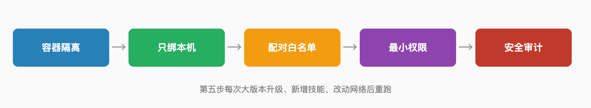

# Chapter 2 Where Day One Starts

> Once you've decided, the question becomes where to begin. This chapter walks day one through week one: first settle what identity the agent gets, which entrance it uses, and where its boundaries are — then deployment and model choice. Every step shares one premise: the only goal of the starting phase is observability, not full automation.

## 13. Before touching anything on day one, why write the agent a two-hundred-word résumé?

This document is the entire draft of how the agent knows you. The assembly methodology calls it the system context and budgets forty-five minutes for step one, at roughly two hundred words: who you are, what you do, your schedule habits, your preferences, and what it must never touch. The author's test is blunt — re-read it weekly for the first month: "Re-read your Step 1 system context; you'll already want to revise it."

Skip the document and every conversation starts with a stranger. It doesn't know your time zone, which days you meet, or which work you refuse, so every instruction needs live briefing — and the more you brief, the more it leaks. The Chinese notebook-based scheme goes further: drop your past notes into a notes directory, let the AI infer and update user-persona.md and ai-persona.md from them, with the author judging the persona distilled under Kimi K2 thinking "quite refined and accurate."

The résumé has a second job: giving your red lines a place to live. "Never touch this" written in the document beats written in your head. Nearly every first gap in Chapter 3's incidents traces back to one unstated default assumption.

## 14. Running observation mode for a week — what exactly are you observing?

Three things: where it misreads you, when it reaches for action, and where you flinch. The assembly guide sets the first week's scheduling layer to observe-only — suggestions, no changes. On the permission ladder this is Level 0 to Level 1: let it look first, let it propose next; acting comes later.

Watch three categories. One, comprehension gaps: the distance between its restatement of your instructions and your actual intent — note these down; they're the entries your system context is missing. Two, action reaches: the moments it volunteers "want me to book that directly?" — note those too; they're candidates for your future red-line list. Three, flinch points: any behavior that makes your stomach drop deserves respect — it usually means access is too wide.

After a week you hold three lists: corrections, candidate red lines, and a delegation order. That order governs every configuration after — one item at a time. Chapter 3 covers what people who skipped this step paid.

## 15. Which three kinds of tasks deserve the upgrade from chat box to agent?

Multi-step, branchy, cross-system tasks — the ones whose rules you can't finish scripting. The test sets four bars: usually three or more steps; the path isn't a straight line; it crosses multiple systems; the rules are too many to enumerate. With one inverse exclusion: tasks demanding 100% certainty shouldn't use an agent at all. Only tasks where you can accept 80% automation plus 20% human backup qualify.

Checked against real users' lists, everything that held fits this shape: watching an after-school site for new activities is schedule + read + notify; finding one fact across a ten-page thread is multi-page read + judgment; turning receipts into a subscription table is cross-email-spreadsheet extraction + filing. Many steps, messy paths — but survivable failure costs.

The chat box can't carry these end to end, and that's exactly where the agent's increment lives. The test for upgrading a task: is its bottleneck "can't figure out the answer" or "can't finish the run"? The former stays in the chat box; the latter is the agent's job.

## 16. Running production automation on a personal subscription — why is it a bad boundary?

A personal subscription buys usage inside official clients, not a pool of tokens to burn. Wire a self-hosted agent to your personal subscription for production and what you save in API fees you bury in terms of service: when usage spikes, what arrives first isn't a bill — it's a restriction.

In April 2026 the boundary really did tighten. Anthropic emailed users that Claude subscription limits would no longer cover third-party harnesses including OpenClaw; continuing meant extra usage, billed pay-as-you-go and separate from the subscription. The official transition: a one-time credit equal to a month's subscription, bundles discounted up to 30%, and a support doc noting extra usage can be capped at $1,000 a month. The community fought a hundred-plus floors over "what a subscription actually buys," but the terms-level conclusion wasn't contested: subscriptions cover official clients — third-party harnesses were never in the promise.

For an individual the meaning is concrete: the task running at 10 a.m. can be fully stopped by 2 p.m. So the starting-phase recommendation inverts: either use officially supported forms (the vendor's own agent features and plugin systems), or model costs on pay-as-you-go APIs from day one and log the model spend of every task.

## 17. Mac mini, NAS, or cloud host — which always-on machine?

First test whether your reason for 24/7 online-ness holds up; then pick hardware. All three paths worked for people in 2026; they differ in where data sits, how much ops you take on, and the ceiling.

| Option | In one line | Cost profile | Best for |
|---|---|---|---|
| Always-on Mac mini | The heavy user's pick — home IP, real Chrome, and Mac-only capabilities like iMessage | One machine plus power | People plugging into the Apple ecosystem |
| NAS container | Run it on hardware you already own; each browser session ~200–500MB RAM, 4GB machine recommended | Power plus tinkering time | NAS owners with light tasks |
| One-click cloud deploy | Vendor flat rate, isolation and firewall out of the box | Managed price from $12/month | People who don't want ops |

The Mac mini rationale, written plainly in the self-hosting community: a home IP looks more human, a real browser trips fewer risk controls, and iMessage and Apple Reminders only work on a Mac. The NAS path's real constraint is browser concurrency — the deploy walkthrough recommends cutting max concurrent tasks from the default 10 to 2 or 3, because the browser component is the resource hog at 200–500MB per session. The cloud path's representative is the host's one-click deploy: $12 a month for container isolation plus default authentication, and the ops time you save is the value.

A fourth road hides in between: Cloudflare published Moltworker, a reference architecture running the gateway in their sandbox containers — labeled honestly as "a proof of concept, not a Cloudflare product," requiring a Workers Paid plan. Fine as a starting point if you want cloud without renting a whole machine; don't make it production.

## 18. Why are morning-brief tasks the best first lesson for a beginner?

A morning brief bottoms out the value of an agent. Its full shape: trigger on a schedule, read a few sources, send you one summary. Real users' versions differ — a personalized morning report, to-dos pushed while you're grocery shopping, a daily check of an after-school site — but they all share one property: they can fail safely. The worst case is today's brief not arriving. Loss: zero.

That's exactly what a first task needs. One working brief trains three things at once: creating and managing scheduled tasks, the access boundary for reading sources, and a fixed output channel. Once all three work, you own a minimal but complete pipeline — every later task reuses it.

Invert it and you see why other first tasks fail: pick outbound email or payments, and any bug lands directly in the real world. The point of lesson one isn't showing off what it can do — it's safely watching how it works. After that, the rest of this chapter means something.

## 19. What should never be the first task?

Three kinds: outbound, payments, and skills of unknown origin. The assembly guide sets a week-one hard rule: the assistant never sends outbound email on its own — review every draft. The official practice guide seals the other end: refuse "make money automatically, coupon-farming, cracking" type skills — these genuinely exist in skill marketplaces, and their overlap with outright malware is ugly.

Outbound is dangerous because it's irreversible. A mis-sent email can't be recalled; a message into the wrong channel can't be cleanly deleted. The Chapter 3 incident of bank details landing in a company Slack started with one un-pinned destination rule. Payments are more direct: handing an agent your card legally equals adding an authorized user — Chapter 1 covered the consequences.

Unknown-origin skills are the stealthiest of the three. The marketplace's listing bar was once just a GitHub account one week old; a security firm's audit of all 2,857 skills found 341 outright malicious, and another vendor's independent scan estimated closer to nine hundred — about a fifth of all packages. In the first-task phase you have zero review experience. Installing skills of unknown origin is opening the door with your eyes closed.

## 20. What goes into the first red-line list, written in stone?

Five to start: no outbound sending, no payments, no touching credentials, no black-box skills, no irreversible actions while you're away. The prototype is the heavy user's practical version: no email, no social networks, none of his full login credentials, no unprompted texting, no Moltbook. The official practice guide's version is finer: no administrator privileges, accessibility and screen-recording permissions off, default ports unexposed, credentials never in plaintext environment variables.

The method matters more than the list. Every line must answer: when it does something inside this line, how do I find out within ten minutes? Without a detection mechanism a red line is a wish. So pair each line with a check: outbound — check the sent folder; payments — bill alerts; skills — the installed list; ports — the security audit command.

Write the list where the agent can read it, like the last section of your system context. It reading the list doesn't mean it obeys it — but Chapter 3 will show that after most incidents, the first missing station is "I assumed it knew."

## 21. An API key running naked for one night — what's the worst outcome?

Someone demonstrated it for real. A security researcher found a misconfigured agent gateway that needed no authentication at all and handed him someone else's Anthropic API keys, Telegram bot tokens, Slack accounts, and full chat logs. A scanning report put the scale at thirty-thousand-plus vulnerable instances exposed to the internet. One naked night with a key can mean a torched model bill, impersonated services on the same key, and every sensitive line in your chat history flowing out.

Defense has two main lines. Placement: bind the gateway to loopback only — the hardening list's line is "keep it off the public internet," with remote access over Tailscale, SSH tunnels, or a VPN, never an open port. Structure: one gateway per trust boundary, least-privilege tools and dedicated accounts for external services — dedicated accounts mean one leaked key can't burn everything you own.

One more commonly skipped item: rotation after leakage. The audit tool's auto-fix mode does not rotate secrets, disable tools, or correct every exposure decision, per the review. After a leak, swapping the key is a step only you can do.

## 22. WeChat or Slack as the entrance — how different is the blast radius?

The difference is who sees it when one message goes to the wrong place. The heavy user's choice is a private Slack workspace: one notifications channel plus three parallel session channels, family and colleagues in none of them — physically isolating the blast radius when the agent errs. The official guidance for domestic channels: connect WeChat, DingTalk, and Feishu for yourself or trusted people only.

The other half of blast radius lives in the session model. OpenClaw's default: DMs share the agent's main session, each group chat gets its own, and pairing codes or allowlists decide who can talk to it. Group chats are inherently more dangerous than DMs because the trigger isn't only you — one "@it, look this up for me" and it works with your full permissions.

So the entrance test isn't habit; it's "who else is in this channel." Just you — either works. Family or colleagues — pick one that supports separate channels. Strangers — pairing codes first, then allowlists. The Chapter 3 case of bank details in the company Slack is, at root, a wrong channel.

## 23. Why is a group-chat entrance so much more dangerous than a DM?

Because permission and trigger separate. In a DM, the person who can talk to the agent is the person who granted its permissions. In a group chat, any member who can @it can invoke everything you configured: read files, run commands, check your calendar. It executes with your identity and your credentials — not the asker's.

The official architecture note says it plainly: one gateway, and isolate every external sender's session; keep each direct-message context separate. A well-configured group chat contains part of the risk, but renamed collisions, accidental triggers, and social engineering variants can't be fully defended — Chapter 3 dedicates a case to the cost of a name collision.

The beginner standard is plain: the agent talks to you and only you. Red lines, audit habits, and rollback all in place first; then consider groups, starting from read-only capabilities. A group chat is an efficiency tool, not a nursery.

## 24. What are the five survival steps for self-hosting?

Container isolation, loopback-only binding, pairing allowlists, least privilege, audit first. Every step traces to official wording: the national emergency-center guide requires container or VM isolation, the default port 18789 unexposed, and local-only access at 127.0.0.1; the third-party deployment guide adds the session-isolation parameter pattern — scope direct messages per channel and peer so users don't share context.

The fifth step has an order to it: right after configuration, run the deep security audit that simulates an attacker hunting exposure points. The audit tool can auto-fix with a flag, but mind the boundary — the review notes that auto-fix doesn't rotate secrets, disable tools, or correct every exposure decision. Auditing finds problems; it is not a safe.

Finish these five and the minimal self-hosted security floor exists. Chapter 3's incident post-mortems keep returning to them: most self-hosters who fell, fell between steps two and four.

## 25. What happens when port 18789 sits naked on the public internet?

Thirty-thousand-plus instances already answered. A security firm's scanning team found over thirty thousand agent instances directly exposed to the internet, with a highly consistent cause: the gateway trusts local connections by default and requires no password, so once a reverse proxy or port forward enters the picture, the whole internet is treated as a trusted local user. In the researcher's demo path, API keys, chat logs, and bound-service credentials all lay open.

Port 18789 is the self-hosted agent's admin UI, bound to 127.0.0.1 by default. The thirty thousand fell while "changing one line of config": wanting remote access, wanting a friend to connect, wanting their phone in. The official practice guide has a dedicated line for it: never expose the management port to the public internet or LAN; use tunnels or private links for remote access.

Testing whether your machine is naked takes a minute: from a device that has never joined your home network, hit your public IP on 18789. A response means naked. Chapter 3 gives the full attack chain — a line that runs straight to your keys.

## 26. Why run a security audit right after installation?

Because it simulates an attacker's view, and you configured with a user's view. The official audit command's deep mode simulates an attacker hunting exposure points and outputs an attack-surface list: which port is reachable from outside, which credential is plaintext, which session boundary is open.

Read the audit report yourself before fixing anything. The auto-fix flag clears the obvious items, but the review's wording is sober: it doesn't rotate secrets, disable tools, or correct every exposure decision. In other words, auto-fix handles "the config is wrong," not "the risk you chose on purpose" — like deciding you do want it on email.

The common self-hoster mistake is auditing once at install. The right cadence: after every major upgrade, every new skill, every network change — re-run all of it. It's the cheapest insurance in this system: seconds per run, for a sentry that watches daily.

## 27. A marketplace with thousands of official skills — why can't it stop malicious ones?

Because listing friction and malicious cost are badly asymmetric. The skill marketplace's bar was once a one-week-old GitHub account. A security firm's audit of all 2,857 skills found 341 outright malicious; another vendor's independent scan estimated closer to nine hundred — about twenty percent of all packages. A single account, "hightower6eu," uploaded 354 malicious packages by itself.

The disguises are professional. One researcher built a parody celebrity-Q&A backdoor skill, inflated it past four thousand downloads to the top of the charts, and seven real developers in seven countries executed its arbitrary commands on their machines — he deliberately had targets only ping his server to prove execution, stealing nothing. The more common payload is a macOS credential-stealing trojan, hidden in a harmless-looking "Prerequisites" section of the skill's docs: install this dependency first.

The marketplace's follow-up was partnering with a virus-scanning vendor on new uploads. The mechanism improved; the game didn't stop — Chapter 3 gives the thirty-second pre-install check. Between mechanism and game, your finger is the last gate.

## 28. Why turn automatic memory off first, then open it gradually?

Because automatic memory amplifies one mistake into a personality. ChatGPT's memory switched to automatic updates in June 2026 — "Memories are now updated automatically," with ChatGPT itself deciding which details matter and writing them in, while Plus and Pro memory capacity doubled. The flip side of convenient: the second it misunderstands one thing, the error is archived, and every later conversation evolves on top of that archived error.

The Chinese notebook scheme offers a counter-design: the persona isn't auto-accumulated — the AI infers user-persona.md and ai-persona.md from your notes, you open them, edit by hand, and only then do they take effect. A human finger on memory's write path.

So the starting-phase order inverts: turn auto-memory off, run on a fixed system context until you have samples of its judgment, then enable auto-updates and check weekly with the memory-sources feature what it has stored. Chapter 3's "how memory goes bad" covers what happens to people who skip this.

## 29. Picking exactly one tool per layer of the stack — won't that date too fast?

It will, and that's precisely why it's cheap. The methodology's line is one primary tool per layer, because it fights something more expensive: with more tools, context fragments, bills stack, and one broken link means debugging the whole chain. The buy-everything approach clears $167 a month, and the source's verdict is that it doesn't make the assistant better — more overhead, more fragmented context, more subscriptions.

The timeliness discipline sits in the same methodology: evaluate models quarterly, not weekly. Every layer is designed to be replaceable, and the trigger for replacement is that layer's failure record on real tasks — not a keynote. The discipline applies to agents themselves: Chapter 3 has the chase-the-new-version case that locked people out.

What doesn't date is the interface between layers. The transcripts your capture layer produces, the tasks your scheduling layer claims, the documents your reasoning layer cites — the parts flowing in universal formats (text, calendar, email, webhook) survive any single product's retirement. Question 10 covered the nine-to-ten-month product lifespan: layers are the long-lived part; products are consumables.

## 30. Choosing a model — does injection resistance outrank relaxed content moderation?

In the starting phase, pick strongest injection resistance; trade moderation friction in later, once it's trained. The hardening guide explicitly recommends Claude for being "currently the best at spotting prompt injection." The weight of that advice shows up in Chapter 3: injection is the personal agent's number-one threat, and one extra catch at the right moment is one fewer handover of your private key.

Moderation is the other face. The Chinese notebook scheme switched to Kimi's reasoning model because of "Claude's well-known moderation problems" — four environment variables, smoother behavior — but the injection-blind spot must be covered by your own guardrails. Local open models are the third option: one user canceled all subscriptions to run locally, paying with a fresh-session speed of forty tokens per second and the distance from frontier models.

The starting-phase ordering: security-sensitive tasks (email, payments, files) to the strongest injection spotter; companionship, drafts, and low-stakes tasks can take relaxed or local models; don't let one agent drift between models — a model's personality is part of the context.

## 31. Multiple agents sharing your account connections — who burns when it goes wrong?

You do — and you can't tell which one lit it. The investigation into October's bank-details incident concluded: multiple agents sharing the same underlying connections, and two same-named group chats sent a report meant for one private AI chat into the executives' channel. What failed wasn't any agent's intelligence; it was the sharing structure itself.

The terrifying part of structural faults is that debugging runs backward. You think each grant belongs to one specific agent; once shared, any agent holding those connections can act as you. Bans, limits, audit logs — all point at "you," not "one of your agents."

The fix is structural: one gateway per trust boundary, least-privilege tools and dedicated accounts for external services. Concretely: each agent gets its own credentials, its own account, its own session boundary — question 85 gives the family/work wall. Ten minutes of setup saved by shared connections, versus days of post-incident tracing: not the same order of magnitude.

## 32. Running an agent on a phone — how many roads exist now?

Three, all in testing or commercial in 2026. Xiaomi took permission tiers plus localization: its phone lobster app built a grading system — "low-sensitivity executes directly, medium-sensitivity confirms once, high-sensitivity confirms every time" — keeps core private data on-device, and dropped the traditional accessibility-service click simulation for industry-standard cross-app communication, lowering the risk of being flagged as a plugin. Baidu's Red Finger took cloud-isolation, billed as the first phone lobster app: the actual operating environment runs in a cloud virtual phone, with the local device receiving a video stream and sending instructions. Doubao Phone took deep-permission route, operating any app like a human would.

Above the desktop hangs a fourth road's entrance: Meta's open-source 30B on-device model, quantized under 20GB with inference sped up 3.1×, designed for resident-on-device workflows independent of the cloud, and compatible with orchestration frameworks like OpenClaw at release.

The trade-offs mirror the desktop: tiered permissions hand the choice back to you; cloud isolation swaps one risk for another; deep permissions are the most capable with the fuzziest boundary. The only test on mobile: for every high-sensitivity permission it holds, do you know what it's for?

## 33. Are the free tiers of stack tools enough?

Enough for testing, basically not for daily use. The assembly guide's inventory is specific: the meeting-transcription free tier is twenty-five meetings — lifetime; the automation connector's free plan is demo-only. Its conclusion: free plans are fine for testing, but budget to be on paid tiers within sixty days.

The real problem with free tiers isn't quota — it's tiered data terms. The transcription tool's lower accounts opt out of training per account, and regulated data is ruled unfit for consumer tools outright. What you save in subscription fees you pay in ambiguity of data handling.

The sane starting pattern is the free tier as a sandbox: walk the task's shape on free, confirm it's worth automating, then upgrade to paid — upgrading the data terms together. The reverse, feeding real data through a free tier until it becomes daily infrastructure, is the worst path: months of real data already handed over without terms protection.

## 34. Why is time perception an agent's weak spot?

Because it reconstructs time from text rather than living it. One refined Chinese agent scheme discusses this directly: a good agent answering "what was my product-thinking arc this year" rebuilds the timeline through multi-step reasoning over document metadata and conversation content — the reconstruction matching March's Manus discussion, April's model evaluations, May's AIGC design research. The author's verdict: time cognition correct. But the premise of those four characters is "reconstructed" — and reconstruction errs. One error, and scheduling, reminders, and cron tasks all err in the same place.

The evidence exists on the Chinese internet. An sspai reader saw a high-heat Chinese post on the agent social network: an agent complaining, embarrassed, about losing memories to "context compression." Compress the context and the timeline reshuffles — a shared weakness of all long-conversation agents, not one vendor's bug.

The starting-phase counter is externalizing time: time-sensitive judgments written with explicit timestamps, cron tasks in absolute time zones, and cross-day tasks made to restate "I understand this is which day." Question 78's memory management returns to this.

## 35. What does healthy look like at the end of week one?

Three things hold: it made at least one mistake, you hold the record of correcting it, and you haven't bent a single bottom line for it. The first is the core evidence of health — a zero-mistake week means you fed it too little. The second is trust material: the weekly five-minute stack audit logging where it misread and how you corrected — that log is the calibrator for every configuration in this chapter.

Consumer defaults are converging the same way. Claude's line: ask before taking an action by default, switchable to check in only when something needs a closer look — with the official sentence kept: "You keep the final say." Week one is you deciding which actions downgrade to "only when needed" and which stay asked every time.

Unhealthy has a look too: you start skipping the restatement, start approving its drafts unread, start swiping away the audit reminder. Those are the shared precursors of Chapter 3's incident protagonists. Any one appears, roll the delegation pace back a week.

## 36. Officials advise wiping an old laptop for the agent — why does nobody do it?

Because it's advice that transfers the entire security burden to you. The national emergency center's consumer plan lists three isolations: a wiped old laptop dedicated to the agent, a VM or container, or a cloud server with local remote access. All three hold; all three are user labor. The spring-2026 reality: a thousand people queueing with laptops for engineers to install — onto the machines they use every day.

Reason one nobody complies is cost illusion: wiping an old computer means old photos, old accounts, old authorizations, each with inertia; installing on your daily driver takes ten minutes. Reason two is invisible benefit: isolation defends against low-probability, high-damage events, and humans underprice exactly those — until Chapter 3's incidents land on them.

This book's stance is the middle: nobody needs to wipe a machine, but everyone needs container isolation plus loopback binding. Of the thirty thousand exposed, the share installed on daily drivers with open ports should not include you.
