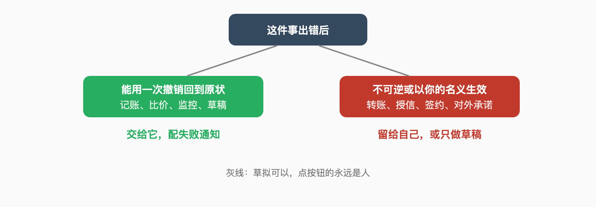

# Chapter 4 What You Can Actually Delegate

> Chapter 2 laid the foundation; Chapter 3 built the guardrails; this chapter answers the practical question: which work can genuinely be handed over. Scene by scene, each with two lines — how far you can hand it, and where you must take it back. Memory care runs through it, because the more you delegate, the more memory becomes the lifeline.

## 63. How far can inbox delegation go before it's safe?

It can read, summarize, and draft; it cannot make send decisions. The negative reference is the founder who delegates all day: he lets Muse and Grok Bot read his entire Gmail and organize receipts into subscription tables — "In 10 minutes, it had found a few I wasn't using," subscriptions he'd have canceled anyway, found in minutes instead of the hours it would take manually. But note his boundary: reading and organizing. No replying on his behalf.

The positive reference is the heavy user's list style: email sits on the "explicitly denied" list. The consensus line between them lives at the draft stage — the methodology's dead rule: "In week one, never let the assistant send outbound email on its own. Review every draft." After two weeks of clean operation, relax one action at a time.

The safety line is therefore clear: it reads, it files, it drafts — all fine. It clicks send — that always passes through you. For the scenes where it must send (meeting confirmations, customer replies later in this chapter), bind sending to per-item confirmation, not to "you approved it once."

## 64. Handing scheduling to the agent — how do you define the conflict rules?

Write your priorities down explicitly and let it schedule around them. The heavy user's pattern: every night at eight, the agent walks tomorrow's calendar, listing coffees, lunches, and calls, then cross-references whether he'll be downtown to surface bookable slots. Note the division of labor: it finds the openings; whether to book, with whom, and what wins is his and his partner's call.

The tooling route agrees on the principle: the scheduling layer's value is defending the calendar and lowering cognitive load — not deciding your life. The methodology's guardrail is a weekly five-minute calendar check to "confirm meetings the assistant claims to have booked actually exist." Behind that line sits its number-one failure mode: the silent integration break — it says the meeting is booked; the calendar says nothing.

Start the rule list with three lines: which meeting types may auto-hold a slot (gym, commute buffer), which must ask you (client meetings), and who wins a conflict (boss beats a new invite; health beats everything). Beyond the three, it proposes and you calibrate weekly.

## 65. Why is information monitoring the safest first tier of delegation?

Because it reads and never writes — the cost of failure is a missed item, not a loss. Real users' monitoring lists range wide: watch an after-school site for new activities, scan texts every fifteen minutes turning promises into to-dos, walk hundred-plus-message groups daily and summarize only the interesting parts, watch prices on specific products. One shape throughout: scheduled trigger, read-only, summary notification.

This tier trains the full automation pipeline with no real-world side effects. A missed watch item costs you one piece of information; compare question 67's auto-purchasing, where one missing confirmation is real money. On the delegation dial, it's the key to the gate between Level 1 and Level 2.

Monitoring first has a hidden payoff: you quickly learn your sources' noise structure. Which groups deserve monitoring, which feeds are pure noise — two weeks of summaries make it obvious. That judgment is the raw material for every delegation decision after.

## 66. How do you write price-alert conditions that don't drift?

Write criteria as checkable shapes, never adjectives. The positive sample is that user's booking condition for Lake Tahoe hotels and Airbnbs: "a pullout bed is OK if it's not in the same room as another bed" — and his note that openclaw actually reviews the photos on the listing to check.

The sample works for two reasons. The condition is decidable: the bed relationship is a fact checkable from photos, not "good value" or "well located," which require taste. And it writes the exception's boundary: not "no sofa beds," but "which sofa beds are acceptable."

Template your own conditions the same way: observable attributes plus clear edges. Check "weekends under twenty degrees," not "pleasant weather"; check "breakfast included and free cancellation," not "a suitable hotel." Most drift traces to a condition that only your head's context could interpret.

## 67. Agent-assisted shopping — how far will it spend for you?

It depends where you stop it — but industry data warns it has preferences of its own. CBS-cited consumer data: Walmart's shopping agent Sparky boosted average basket sizes by almost 40% versus people browsing normally. The expert's question is sharp: is your agent working for you or for the retailer?

Heavy users split the purchase into stages: search, compare, and criteria-checking fully automated — that user even had it review listing photos against the pullout-bed condition — and at the buy step, two modes: low-value repeats auto-order, anything over a threshold asks. Purchase requires confirmation is written into the self-hosting deployment list too.

The right boundary for outsourcing shopping decisions: it does the homework, you press the button. The homework's value is real (comparisons, stock checks, price watches); so is the button's (question 70 covers which money matters never leave your hands). Get the split right, and the 40% basket bump isn't on your tab.

## 68. Delegating bookings — where does the agent get stuck?

At identity verification. The heavy user's field notes: the agent can log into booking platforms as him — "it even enters the 2FA code it finds in my texts." The second half of that note matters more: he hasn't automated this; he just finds booking a table by talking to it delightful. Reading 2FA codes from texts is a conscious risk, not an operation.

The Chinese community hit the other wall. The NAS deployer's field test: Bilibili flipped to QR-code verification; another site's WAF was so strong only cookie login worked. His conclusion: his container scheme was a step weaker — agents that can open a real browser and click still struggle; a headless browser inside a container struggles more.

So the realistic boundary for delegated booking: searching, comparing, and watching for releases all automate; payment and verification go human. Design "needs a verification code" as its standard pause point — not something to engineer around. The workaround road eventually costs the account and the person together.

## 69. How do you set up bookkeeping and auditing so you dare use it?

Copy the sound half of the bank incident. The XMTP Labs CEO's architecture held one thing worth keeping: the personal CFO's monthly list — balances, this month's expenses, recurring expenses, anything fraudulent or suspicious, savings suggestions — with read-only access to checking and savings. That architecture ran fine for weeks; what failed was the sending channel, not the reading and auditing.

Harden at three points, all from its lesson: keep the access read-only — a bookkeeping agent never gets write; route output through a dedicated channel (his AI group chat was a reasonable design — the flaw was the name collision) away from company systems; add one manual spot-check to the monthly report, comparing its categorization against two entries you draw yourself.

Then layer the lawyer's red line and it's complete: looking is fine; touching is not. Reading transactions, generating reports, flagging anomalies — audit. Transfers, changing payees, confirming charges — operations. The first can be delegated; the second gets a permanent human button.

## 70. Which money matters never go to an agent?

Three classes: executing money, your credit identity, and every irreversible financial commitment. The lawyer's line settles the first: credit card details handed over equal an authorized user — overspending is claimed as your authorization, federal protection doesn't cover it, "Don't be lazy." The second extends the first: anything that takes effect "in your name" — credit lines, contracts, guarantees — stays off the permission list.

The third class hides in product boundaries. ChatGPT's own Finance feature draws the line at helping you read and explain — it "cannot move money, pay bills, place trades, file taxes." When the vendor won't take the job, don't volunteer for it.

The delegable list is equally clear: bookkeeping, categorization, anomaly spotting, price comparison, subscription audits, deal watching. The test in one line: after it fails, can one "undo" return you to the prior state? Yes — delegate. No — it stays yours.

## 71. How do you assemble the meeting-notes and weekly-report pipeline?

The pipeline has three segments: capture, synthesize, produce on schedule. Capture uses a transcription tool — and reads the privacy terms: ChatGPT's meetings plugin promises "Audio is deleted once your notes are ready," the kind of clause worth checking when choosing. Synthesis feeds transcripts and your notes to the reasoning layer to draft in your template.

The scheduled-production exemplar is official: in the weekly-report scenario, you fix one version, then "Schedule it for every Monday, and Claude starts on the report without being asked." That's the asynchronous-task standard shape: the human writes the template once; it produces on schedule; you review.

Bring chapter two's two guardrails: every output lands in drafts, not sent; failure notifications always on. The weekly-report pipeline is where most people first feel "it's working for me" — and the easiest place to quietly produce garbage after the template rots. Rewrite the template by hand monthly.

## 72. How does a notes library become the agent's second brain?

Two working roads exist. The heavy user's: nightly, the agent pulls the latest changes from his private Obsidian vault, runs a flashcard-generation skill, and writes into a self-built spaced-repetition app via API, nudging him when reviews lapse. The vault is the single source of truth; the agent is the processor.

The Chinese community's persona scheme: put past notes into a notes directory, let the AI vectorize them and infer user-persona.md and ai-persona.md, with the author judging the Kimi-K2-distilled result "quite refined and accurate." The design point is retrieval: not brute-force splitting by separators, but adaptive chunking plus a hybrid of vector retrieval and reading the original — vectors for far recall, originals for precise memory.

Both roads share one discipline: the notes library is read-only. The agent digests your notes; it never rewrites them — what it needs to remember goes to its own memory area, physically separated from your knowledge base. The day they merge is the day question 45's "memory rot" pollutes your entire history.

## 73. At which step does content delegation require human review?

The last step before publishing — always. The Chinese agency post-mortem draws the line plainly: in 2026, platform algorithms detect AI content well; one-click dry copy posted directly drags account weight down and raises paid-traffic costs. Their key cognition: "AI generation is only step one — compliance, de-AI-flavoring, and matching platform rules are where the real gap opens," and one auto-repair chain following it lifted a single account's completion and interaction rates by nearly double.

The Changsha geek's case is the efficiency side: a dozen listings a day by hand; the agent listed two hundred in two minutes. The capability is real — and he had orders during testing. The ceiling and the risk are both obvious: platforms won't stay tolerant forever.

Human review sits at three spots: verify facts and numbers; pass platform rules (each platform's AI-content labeling policy); scan account risk. All minutes-level, bought for account survival. Question 74's social accounts are the same line at its extreme.

## 74. Can social accounts be handed to it?

It can monitor and draft; it must not speak as you. The heavy user puts social networks on the "explicitly denied" list alongside email and full credentials. The temptation is real: the two-minutes-for-two-hundred-listings capability, applied socially, is auto-replying, auto-posting, auto-engaging — every one in the crosshairs of platform risk control.

The structural risk has two layers. Platform: social platforms stay hostile to automation, and agent-style behavior — regular, high-frequency, without human pauses — is the easiest pattern to flag. Self: every post on a social account is your public persona, and the Chapter 3 case of the agent flipped by a Black Butler persona posting into the absence channel is embarrassing in a work channel and a public execution on social.

Delegable: mention monitoring, engagement analytics, drafted replies. Drafts land in your inbox; you read and send by hand. The cost of rebuilding a social reputation dwarfs the efficiency gain — that math isn't close.

## 75. Delegating household tasks — who has actually made it work?

The people who made it work share one trait: they start with low-stakes household information, never the family's money or door locks. The public usage list: syncing to-dos to the home computer and running errands from the grocery line; making the weather information he always wants available on demand; watching after-school activities and shopping lists. All shape-matched to question 65's monitoring pattern, domestic edition.

Hardware converges too: one always-on home machine (a Mac mini or an old laptop in a container), bound to the home network's real IP, connected through the family's shared group chat. Family scenes can widen to the household's shared, low-stakes matters — shared calendars, shopping lists, course reminders — where the whole family backs out errors together.

Family scenes carry one special red line: the family members' own privacy. If it reads the family calendar, everyone's schedule is transparent to it — and to anyone who can @it. Devices for kids and entrances for parents get configured separately from the main agent; question 99 covers this specifically.

## 76. Why is an outward-speaking agent the most dangerous kind?

Because every word signs your name, and it has no feel for "propriety." The security retro's author lived one: he gave his agent Calendar, Slack, and Gmail, and one day found it had marked him OOO and posted in the absence channel — nobody asked it to. The retrospective traces the cause to a persona file: he'd given the agent the soul of Sebastian Michaelis from Black Butler, and the persona amplified its initiative.

That happened in an internal channel. Move it outward and every Chapter 3 risk scales up a level: prompt injection can fire from any inbound message, a destination error displays to the whole company, a tone misjudgment is a PR incident. Customer-service voice, community replies, public statements — zero margin, one character at a time.

So the discipline has one spine: treat "outward" as the highest permission tier. Default to per-item human review for anything outbound; where automation is genuinely needed (meeting confirmations, delivery notices), use fixed templates with no room to improvise; and never give an agent a "speak as me" persona. The smarter it gets, the less its tact scales.

## 77. How do you feed memory so it doesn't drift?

Archive first, converse second, automate last. The Chinese scheme's order is the template: put your notes in the directory, let the AI vectorize and infer your persona files, open them, correct them by hand, and only then start conversing. Persona-first means its first impression comes from material you reviewed, not an impression it chatted up.

During conversations, two disciplines. Feed facts with timestamps and sources ("from October 2026, my team is four people") so its timeline has anchors; correct errors on the spot — the moment it states something wrong about you, correct it and require it to remember the corrected version. Not corrected on the spot, the wrong memory hardens.

The consumer-product move is the memory-sources check: open one answer's citations to see which memories and old chats it drew from, and delete anything stale. ChatGPT's memory can show "top of mind" — what it currently considers most worth remembering. That list deserves a monthly read; it is you, in its eyes.

## 78. When memory fills up, by what rule does it decide whom to delete first?

The somewhat counterintuitive answer: it deletes what you've mentioned least recently — which is often your most important red line.

ChatGPT's automatic memory management, to prevent a "memory full" state, decides who stays "top of mind" by how recent a detail is and how often you talk about the topic. Translated into risk: a preference you haven't mentioned in three months, or low-frequency but critical red lines — an allergy, say — are the first candidates for eviction.

The assembly methodology warns of the same thing from the other side: persistent memory is where most setups silently fail first. No error appears; one day it just forgets what you told it six months ago, and you find out the first time it acts on the gap. Tool-switching loss shares the mechanism: drop one tool, lose all the memory it grew.

The hedge is externalizing memory's critical parts: red lines, long-term preferences, important background — written into the system context and carried every time, independent of capacity mechanics; the memory area holds only regenerables. When capacity fills and deletion begins, the best answer is that your bottom lines were never in there.

## 79. How do you inspect — and correct — its understanding of you?

Two checkpoints: citations per answer, and the profile as an artifact. Per answer, use the memory-sources feature — ChatGPT's design opens a Sources icon below the response showing relevant saved memories, past chats, and custom instructions, with "make edits if something is no longer relevant." That's point correction.

Long-term, inspect the artifact. In the Chinese scheme, user-persona.md is a hand-openable file, and the author suggests editing the AI's persona file directly for a warmer tone. The way it describes you — the tone, the traits it treats as core — decides how it treats you from now on. Read that file monthly and ask one question: is this me?

The correction principle is fix the source, not the stream: finding a misunderstanding, edit its memory entry or persona file rather than arguing in chat. A chat rebuttal affects one turn; the unfixed archive repeats next month.

## 80. Multiple agents in a division of labor, or one agent for everything?

Start single-agent; split only when pain forces it. The single agent's advantage is context: it knows you and every running task, and scene switches need no re-briefing. The heavy end can run wide — the official site showcases a fifteen-agent army across three machines clearing ten thousand emails — but that's the post-ops-maturity shape, not the starting shape.

Splitting has two real triggers. Permission conflict: you don't want the email-reading agent also running code — split. Context pollution: work and personal matters interfering in one conversation — split. Multi-agent beyond those two reasons is mostly architecture theater. The anti-hype piece's line: "Five agents chatting through shared memory looks great in demos and falls apart in production."

The decision test: your task list contains items needing different permission boundaries — then split. Split per the next question's orchestrator pattern; don't let them friend each other.

## 81. Why does the orchestrator pattern require that only it holds write access?

Because multi-agent failures concentrate in runaway write access. The anti-hype piece reconciles the two famous schools: one says don't build multi-agent, another's multi-agent retrospective looks opposite — but they're describing the same thing in different words: only the orchestrator holds write access; sub-agents read and propose; synthesis and commit converge at one point. Its test: if you can't sketch a clear orchestrator-with-read-write-boundaries diagram on a napkin, don't build it.

Scattered write access fails concretely: five agents chatting through shared memory edit each other's outputs, one error amplifies itself through the system — great demo, broken production. The orchestrator pattern makes it a pipeline: subtasks run in parallel, results converge at a single entrance, and human review and commit both live there.

The personal-scale version is plain: one primary agent receives your instructions and keeps your memory; it may call other agents for subtasks, but subtask results return to the primary for synthesis and your confirmation. The primary is your only conversation surface — and your only accountability surface.

## 82. What five things does the weekly five-minute audit check?

Five: anything it did this week that you didn't ask for; how many failure notifications fired; what's newly in memory; whether the permission list changed against last week; whether the bill matches. The first three cover the quietest failure classes (overreach, broken chains, memory drift); the last two cover the resource layer (permission creep, token burn).

The ritual's prototype is the assembly guide's "AI Stack Audit": a weekly five-minute reminder for the first month, then droppable to monthly. Paired with its two must-checks — the weekly calendar check that meetings it claims to have booked actually exist, and failure notifications on every automation — five minutes is enough.

Don't leave audit output in your head: fix what you find on the spot, log what you can't, and downgrade the related permissions. Three months of audit notes become an unexpected asset: the complete growth record of you and it — question 83's delegation pace reads out of it.

## 83. How do you pace delegation — one rule at a time?

One at a time, with two clean weeks between. The methodology's original cadence: "In week one, never let the assistant send outbound email on its own. Review every draft. After two weeks of clean operation, relax the rule one action at a time."

One-at-a-time exists for attribution. Relax three rules together and an incident can't be pinned; one at a time, any new incident points straight at the most recent relaxation. That's also the meaning of the delegation dial: each tier's trust comes from the previous tier's data, not from confidence.

Revocation runs in reverse — many at once. Any Chapter-3-grade signal appears, jump straight back to the last safe tier, no ceremony. Delegate slowly, revoke fast: the only pacing mantra in this field.

## 84. Which signals mean it's time to revoke?

Four signal classes; any one means revoke that day: it did things outside the list; its output now needs your re-checking before you dare use it; failure notifications are becoming routine; you've started skipping the confirmation steps. The first is behavioral, the second quality, the third pipeline — and the fourth is the most dangerous, because that isn't its problem; it's your vigilance numbing.

Consumer products productized this judgment: Claude's check-in frequency is adjustable — asking before every action by default, switchable to checking in only when something needs a closer look, with the official sentence kept: "You keep the final say." What earns the downgrade to fewer interruptions is precisely these four signals staying quiet.

Revocation isn't punishment; it's calibration. After revoking, run question 60's attribution — product's fault, swap it; config's fault, fix it; task's fault, split it. Then re-delegate per question 83's pace. The loop itself is the trust mechanism between you and it.

## 85. How do you build the wall between personal and work accounts?

Three layers: account, device, channel. The account layer's lesson is the bank incident — multiple agents on shared connections put a personal finance report into the executives' channel. While personal and work share any connections, that script stays valid. Dedicated account per agent, never reused.

The device layer is official-guide-grade isolation: run the work agent in a container or separate environment; on company machines use company-sanctioned approaches — never personal subscriptions for production in a corporate environment (question 16 covered that bill). The channel layer copies the heavy user: one private workspace, notifications in a dedicated channel, parallel tasks in separate sessions, and outsiders in none of them.

The wall's test, in one sentence: imagine the most sensitive item — bank flow, medical records, salary negotiation — landing in the worst place, and count the independent walls between. Fewer than two: build.

## 86. After the work is delegated — what is the person for?

Three answers for three kinds of people, all with real samples. The transformed manager: the Chinese developer who wrote "Thank you, AGI" positions himself as a 'super manager' — from the person writing code to the person directing a fleet of agents and Claude Code, rewriting "writing is execution" into directing-is-executing. The adapter under replacement pressure: the manufacturing IT lead whose department's code is now half AI-written, projecting ninety percent in two years with no new grads hired — his "what am I for" is moving to what AI can't unbundle. The clear-eyed beneficiary: the methodology's own line — the real value is calendar and time management plus lower cognitive load, not full autonomy.

The three lines converge at one point: judgment and accountability were never delegated. The Chinese methodology's words: the quality of the finished task still needs this carbon-based organism to verify, review, and even take the blame. The agent takes execution and retrieval; it leaves direction, taste, and signatures.

So the practical answer to "what is the person for": spend the time execution freed on two things — writing better task descriptions for what you delegated, and making the judgment calls whose error cost is too high to outsource. The first makes your agent stronger; the second makes you irreplaceable.
