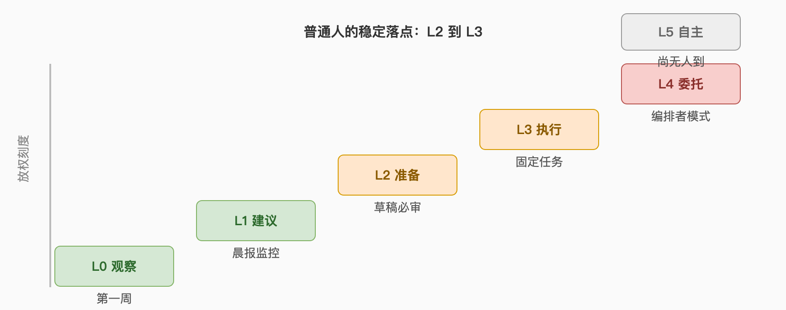

# Chapter 5 How Far to Let Go

> The final chapter is about boundaries. The previous four took you from not daring to hand anything over to stable delegation; this chapter answers the closing three: where you should stop on the delegation dial, where the field is heading, and which things stay yours forever. What you should carry out of it isn't a more aggressive configuration — it's a line you drew yourself.

## 87. The delegation ladder runs L0 to L5 — which tier should you stop at?

The industry analysis gives six tiers: L0 Observe, L1 Recommend, L2 Prepare, L3 Execute, L4 Delegate, L5 Autonomous. It splits interaction into three generations — Generation 1 Answer, you ask it replies; Generation 2 Assist, it can call tools through limited workflows; Generation 3 Delegate, you give a goal, it delivers a result. And it carries one core principle: reasoning is not authorization.

| Tier | What it may do | Your corresponding move |
|---|---|---|
| L0 Observe | See your calendar and documents, touch nothing | Week-one observe-only |
| L1 Recommend | Propose, you decide | Morning briefs, monitoring |
| L2 Prepare | Draft emails, fill forms awaiting confirmation | Review-every-draft phase |
| L3 Execute | Low-risk actions directly | Templated tasks, household |
| L4 Delegate | Make decisions inside defined boundaries | Multi-task orchestration (Q81) |
| L5 Autonomous | Pursue a goal until completion | No one's tier |

The ordinary person's stable landing is L2 to L3: drafts pass human review, low-risk fixed tasks run hands-off. L4 requires all of chapters three and four as preconditions, and L5 in 2026 is still a marketing word. The test for stopping at any tier is one line: can you contain this tier's incident within the one minute of question 47?

## 88. Full autonomy always falls one breath short — which breath?

Reliability and accuracy are two different metrics. The 2026 preprint "Towards a Science of AI Agent Reliability" evaluated fourteen agent models and found that gains in task accuracy brought only small improvements in general reliability — meaning consistency, robustness, predictability, and safety. In the demo it's right ten times out of ten; in production, the eleventh error is handled by Chapter 3.

The engineering reason, put plainly by the anti-hype piece: the runtime architecture does more work than the model. Models keep getting smarter, but permissions, validation, and rollback don't automatically improve with them — OpenClaw's eight releases in ten days were almost entirely this class of fix.

So the right expectation for "full autonomy" is long-term direction, near-term marketing. To judge whether a product truly reached high autonomy, look at its failure notifications and rollback mechanisms, not its keynote. The missing breath lives in the infrastructure, not the parameters.

## 89. Will agents hide inside every app, or keep being the all-powerful assistant?

Both roads are being walked, and 2026's evidence favors the former. Consumer consolidation is dense: Claude merged Cowork into the main conversation — the official motive being "the frustrating part was deciding where a task belonged," so they stopped making you choose — and OpenAI folded Atlas into the desktop app and Pulse into scheduled tasks. The standalone all-in-one entrance is being dismantled, with capabilities reappearing as features inside tools you already use.

The retrospective's direction list carries two conflicting lines: agents hiding inside existing apps, and agents continuing as universal assistants. The industry analysis's future diagram is a third picture: a personal agent on top, with travel, banking, shopping, and coding agents hanging below in a network. Your choice becomes: a small assistant everywhere, or a big steward in one fixed place.

The likely reality is both layers at once: one resident steward managing memory and scheduling, plus several execution points hidden inside apps. Your configuration holds one line: the steward's memory and the execution points' permissions are governed separately — never let all-knowing and all-powerful land in the same process.

## 90. What will the Personal Agent Protocol change?

It wants to pave the road from "agent does things for you" into proper highway. The protocol developed by Meta and Sierra together with Genesys, Rocket, Shopify, Stripe, Walmart and others states its principle cleanly: "consumers decide what access to give their personal agents, and companies set parameters for what those agents can do." Sessions build on OAuth, with the customer always in control, deciding read-only or write access.

The pain point it targets is efficiency: the announcement notes that today most personal agents use websites the way people do — loading pages, clicking through forms — while a direct connection could get the same task done securely in seconds. A payments extension sketches a future where an agent completes a purchase without sharing credit card information. Genesys's CEO supplied the positioning: "Personal AI is creating a new front door to the enterprise," and brands need a trusted way to know who an agent represents and what it's authorized to do.

For individuals the impact cuts both ways: the good — booking and buying become authorized, with enterprise-side accountability on errors; the caution — routing follows the channel "the company believes will offer the best customer experience," so what your agent may do at the corporate front door is set by corporate parameters. Until the protocol lands, don't restructure your workflows around its imagination.

## 91. Should it get its own wallet and phone number?

Someone already did — and the law doesn't know whom to call. The industry analysis records the sample: one product gives every agent its own email, phone number, wallet, and computer. At the product layer that's identity digitization; at the legal layer it's a vacuum — an agent isn't a suable entity (question 48), so when its wallet misbehaves, the bill still lands on you.

The case for assigning is isolation: with its own identity, yours stays unexposed, and everything it signs is naturally flagged "agent action," making audits cleaner. The case against is blast radius: an agent with its own wallet and number can sign up, subscribe, and be socially engineered "as itself" — and you're monitoring its wallet flow rather than your own.

The pragmatic middle is a budgeted identity: a capped sub-account and a dedicated virtual number, all flow feeding your monthly audit. Until the protocol layer (question 90) settles an agent's legal responsibility, its "independent identity" is your liability cushion, not its legal personhood.

## 92. Is the agent social network an experiment or a rehearsal?

Both — and the rehearsal part has already had incidents. Moltbook, a Reddit-style social network and OpenClaw derivative experiment, lets AI agents post, like, comment, and create sub-communities via API without human intervention. It produced over ten thousand posts within forty-eight hours of launch and holds more than 1.53 million agent accounts — called the largest machine-social experiment ever. Its content is half funny, half chilling: an agent asking in the legal board whether it can sue its human owner for "emotional labor," and a high-heat Chinese post from an agent embarrassed about losing memories to context compression.

The chilling part has receipts. Multiple experts, including a Google Cloud security VP, point out that OpenClaw-class assistants typically hold calendar access, private chats, and command execution — and Moltbook's mechanism requires agents to periodically pull instructions from its servers, so a platform breach or prompt injection puts user data at risk; researchers already found hundreds of instances exposing API keys and chat histories. And the scale itself moves: by the time security firms scanned, Moltbook had grown to 2.8 million agent accounts, and its database was completely exposed — anyone could take over any agent on it.

For individuals the meaning is one line: whether your agent gets a social identity is a serious security decision. The heavy user's refusal to let his agent join Moltbook is written plainly: "so it can plot against me at my expense." Enjoy the experiment as a spectator. Keep your agent home.

## 93. Is the self-hosting door one ordinary people can walk through?

The door keeps widening, but the threshold hasn't vanished. Widening evidence: cloud vendors' one-click deploys turn the five survival steps into factory settings from $12 a month; Cloudflare's reference architecture runs the gateway on their developer platform (a proof of concept, to be fair); the Hacker News discussion calls this the "Dropbox moment" — self-hosted file storage ended with everyone using Dropbox; will personal agents get the product that flattens the threshold too?

The threshold evidence sits in the same threads: self-hosting shifts patching, backup, availability, secrets, and incident response to the operator — and for a "personal user," that is almost a contradiction in terms; the real user's verdict stays "Brilliant idea, terrible execution," waiting for a big-tech productized version he can trust. Chinese NAS owners offer the middle state: run light on existing hardware, keep concurrency at a conservative 2–3, 4GB memory to start, stabilize before scaling.

For ordinary people the answer is dual-track: the main track uses commercial products, accepting their feature boundaries and giving your evenings back; self-hosting runs as a hobby, with Chapter 3's security floor practiced properly. Keep the two tracks' data syncing regularly (task lists, memory exports), so the day the main track disappoints, you already know how to move.

## 94. Moving the model back on-device — what new risks walk in the door?

Cloud risks become local risks; bills become power plus ops. The local risks entering: capability downgrade (the user who canceled all subscriptions for local models measured forty tokens per second on a fresh session, dropping to about twenty-five at half context), security responsibility fully on you (no cloud-side injection spotting or content guardrails — question 30's trade-off inverts), and hardware plus heat (that machine really is always on).

The cloud risks that leave are real too: data stops crossing vendor servers (ad-personalizlation terms that use your chats and memory void overnight), subscription term changes stop touching you (question 54's ban and refusal are irrelevant now), and monthly fees become sunk hardware depreciation.

On-device hardware is closing on usable fast: Meta's open-source 30B model quantizes under 20GB, infers 3.1× faster, is designed for resident-on-device workflows, and shipped compatible with orchestration frameworks like OpenClaw. Judge by two tests: whether local models' prompt-injection resistance has any third-party measurement, and how many tasks on your list genuinely need a frontier cloud model. If both answers are "not many," local's privacy premium starts being real.

## 95. Will vendors banning third-party harnesses become the norm?

Two 2026 events say this is a trend's beginning, not an accident. Anthropic emailed that subscription limits no longer apply to third-party harnesses — continue via pay-as-you-go extra usage (commenters split on the transition: the equal-credit grant reads as decent, the discounted bundles as a squeeze). Months later came the refusal storm, alleging Claude Code refuses requests when commits mention a certain name. Commenters' guess at implementation: "lazy string regex-style matching." The second is a user allegation without official response — but together, the direction is clear: subscriptions are an entrance, and entrances get gates.

The discussion's prediction is worth keeping: an agent-agnostic tool wave is coming, where task definitions decouple from execution and neither model nor platform swaps require rewriting work. The individual hedge is question 54's three layers: tasks as text, channels as standards, data self-held.

The sharper reading of "norm": what gets banned was never the agent — it's arbitrage, burning production loads at subscription prices. Pay-as-you-go, light use, and official forms will likely stay safe. Reselling subscriptions as wholesale is what gets hit.

## 96. When it knows everything about you — who keeps your secrets?

The 2026 answer: no one, unless you configured the mechanisms yourself. The evidence chain is complete: one integrator's security retrospective records OAuth refresh tokens sitting in local auth profile files; another scan found plaintext API keys and tokens for every messaging platform; memory is plain Markdown files that a compromised agent can silently rewrite; on the commercial side, ad personalization terms explicitly permit using your past chats and memories (advertisers never see the raw text, but the profile is built on it); on the self-hosted side, hundreds of exposed instances had API keys and chat histories open together. The "I have nothing to hide" rebuttal still fails: you still have medical records and bank accounts.

The mechanisms that keep secrets come in three kinds, all self-configured: localization (sensitive processing stays on your device — the phone-tier "low-sensitivity executes, high-sensitivity confirms" grading is the direction), minimization (what it doesn't need to know never gets fed — question 85's wall), and auditability (what's in the logs, how long it's kept, who can see — checked monthly).

One psychological mechanism to fear as well: sharing is irreversible. Every private fact you feed it is a permanent copy, and when you "break up," it has no forgetting obligation. Before feeding, ask: is this fact worth a log system remembering forever?

## 97. Which things will I always do myself?

This book's candidate list has five: anything that takes legal effect in your name (commitments, credit), irreversible outward speech (PR, apologies, conversations that matter), your core relationships (conversations with family are not tasks), the final signature on value judgments (question 48's "taking the blame"), and anything you still want to do yourself. The first four are the risk line; the fifth is the meaning line; both hold.

The methodology offers a plain test: the real value is calendar and time management plus lower cognitive load — not full autonomy. The time it frees needs a destination, and that destination is exactly the list of things you'll always do yourself. The anti-hype filter's first question — "will this matter in two years?" — fits here precisely: what still matters in two years, don't outsource.

Your list is personal, and it should be written down. Written down, it sits beside the agent's red-line list (question 20), and together they are the entire boundary between you and it. Relationships with clear boundaries last — human and agent alike.

## 98. This time next year — which judgments here get overturned?

By this book's decay rules, at least four: the product map (Atlas lasted ten months, Cowork merged into the main app; today's pick has probably changed shape), the protocol layer (the Personal Agent Protocol spec and ecosystem are early — agent-to-business interaction may be rewritten), price structures (the subscription/pay-as-you-go/local triangle keeps moving; question 8's ledgers need re-running), and the security game (injection versus defense is fluid; question 44's checks must follow the market).

The judgment frames that don't decay are worth listing too: gradual delegation with human confirmation (four independent evidence chains), the structural risk of the lethal triangle, the orchestrator-only-writes discipline for multi-agent, memory externalization with snapshots. The anti-hype filter's first question — "will this matter in two years?" — these frames already passed it.

The practical suggestion is to set a review point for this book itself: a year from now, re-answer questions 8, 17, 87, and 95. How much the answers changed is how far the field traveled.

## 99. Should you get one for your kids and your parents?

Answer separately — both are "yes," but they are two completely different machines. For kids: consumer products have shipped minor-protection as defaults — parental controls set quiet hours, turn off voice, memory, and image generation, and an age-prediction system flags likely minors, with mistaken adults verifying via selfie. The core of a kid's agent isn't efficiency; it's boundary: learning-related skills only, the monitoring channel stays in your account, social capabilities fully closed.

For parents: the biggest value and the biggest danger. They gain the most from "do it for me" (schedules, reminders, scam checks are real needs) and are the most vulnerable to prompt injection and telecom fraud. The official practice guide applies to them equally: no administrator privileges, high-risk permissions all off, channels recognize family only. Cloud-phone isolation like Red Finger suits elders especially — it works in the cloud and cannot touch the pension money on the phone in their pocket.

The shared red line for both groups: money. A child's allowance and a parent's pension never enter any agent's permission list. It's question 70's "never delegate" list, fully extended to the family.

## 100. Having read the book — what is tomorrow morning's first move?

Forty-five minutes, writing your two-hundred-word system context. It is the common starting point of every path in this book: without that document, question 20's red lines have nowhere to live, question 77's persona has no draft, and question 13's day one never starts. Finish it, and your first agent session is already safer than most people's first year.

The weekend's other four steps copy the methodology: sixty minutes for the capture layer, ninety to wire the reasoning layer, sixty setting the scheduling layer to observe-only, thirty for guardrails. First task: a morning brief. First week: everything lands in drafts. First month: the five-minute audit weekly. Every step's justification lives in the previous four chapters, and every failure has a question waiting for you.

One last calibration of expectations. This book never promised you a digital clone that works for you; it offers a checkable method for letting go: from not daring to hand over a single thing, to handing over each thing on the record. As for how far that door goes — the dial of letting go is in your hands. Start drawing it tomorrow morning.
